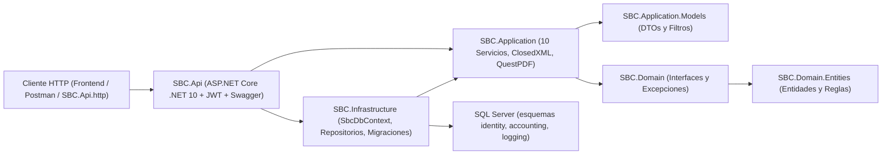

# Manual de Instalación — SBC (DataFlowHub API)

> Guía técnica paso a paso para instalar, configurar, migrar, verificar y desplegar **SBC (DataFlowHub API)** en entornos locales de desarrollo (Windows, Linux y macOS) y contenedores Docker.

---

## Tabla de Contenidos

1. [Visión General y Arquitectura de la Solución](#1-visión-general-y-arquitectura-de-la-solución)
2. [Prerrequisitos del Entorno](#2-prerrequisitos-del-entorno)
3. [Obtención del Código y Estructura del Repositorio](#3-obtención-del-código-y-estructura-del-repositorio)
4. [Configuración de Base de Datos y Secretos JWT](#4-configuración-de-base-de-datos-y-secretos-jwt)
5. [Inicialización de Base de Datos, Migraciones y Datos Semilla](#5-inicialización-de-base-de-datos-migraciones-y-datos-semilla)
6. [Compilación, Pruebas Unitarias y Ejecución Local](#6-compilación-pruebas-unitarias-y-ejecución-local)
7. [Despliegue con Docker](#7-despliegue-con-docker)
8. [Consideraciones para Producción y Seguridad](#8-consideraciones-para-producción-y-seguridad)
9. [Guía de Solución de Problemas (Troubleshooting)](#9-guía-de-solución-de-problemas-troubleshooting)

---

## 1. Visión General y Arquitectura de la Solución

**SBC (DataFlowHub API v1)** es una API REST de contabilidad general desarrollada sobre **.NET 10 (`net10.0`)** y **C# 14**, estructurada en capas inspiradas en *Clean Architecture* y respaldada por **SQL Server** con **Entity Framework Core 10** y **ASP.NET Core Identity + JWT Bearer**.

### Proyectos de la Solución ([SBC.sln](../SBC.sln))

| Proyecto | Responsabilidad | Dependencias de Proyecto | Paquetes NuGet Clave |
| :--- | :--- | :--- | :--- |
| **`SBC.Domain.Entities`** | Entidades de dominio (`BaseEntity`, `Account`, `AccountingPeriod`, `BulkImport`, `JournalEntry`, `JournalEntryLine`, `ApplicationUser`, `TransactionLog`), enums (`AccountType`, `TransactionStatus`) y acciones (`TransactionActions`). | Ninguna | `Microsoft.Extensions.Identity.Stores` (`10.0.5`) |
| **`SBC.Domain`** | Contratos de repositorios (`IBaseRepository<T>` y 6 repositorios específicos) y excepciones (`SbcException`, `DomainException`, `NotFoundException`). | `SBC.Domain.Entities` | — |
| **`SBC.Application.Models`** | DTOs de entrada/salida, `BaseFilterDto`, `PagedResultDto<T>` y filtros por módulo. | `SBC.Domain.Entities` | — |
| **`SBC.Application`** | Lógica de negocio (10 servicios), autenticación JWT, importación/plantilla Excel y reportes financieros en JSON, Excel y PDF. | `SBC.Application.Models`, `SBC.Domain` | `ClosedXML` (`0.105.0`), `QuestPDF` (`2026.2.4`, licencia `Community`), `Microsoft.AspNetCore.Authentication.JwtBearer` (`10.0.5`), `Microsoft.EntityFrameworkCore` (`10.0.0-preview.2.25115.7`) |
| **`SBC.Infrastructure`** | `SbcDbContext`, 6 configuraciones Fluent API, 3 seeders determinísticos, 10 migraciones EF Core y 7 repositorios (`BaseRepository<T>` + 6 específicos). | `SBC.Application` | `Microsoft.EntityFrameworkCore.SqlServer` (`10.0.5`), `Microsoft.AspNetCore.Identity.EntityFrameworkCore` (`10.0.5`) |
| **`SBC.Api`** | Punto de entrada ([Program.cs](../SBC.Api/Program.cs)), `SbcControllerBase`, `SbcGenericResponse`, 11 controladores (40 endpoints), Swagger/OpenAPI y `Dockerfile`. | `SBC.Infrastructure` | `Microsoft.EntityFrameworkCore.Design` (`10.0.5`), `Swashbuckle.AspNetCore` (`10.1.7`) |
| **`SBC.UnitTest`** | Suite de 73 pruebas unitarias distribuidas en 14 clases (`Controllers/` y `Services/`). | Los 6 proyectos anteriores | `xunit` (`2.9.3`), `xunit.runner.visualstudio` (`3.1.5`), `Moq` (`4.20.72`), `MockQueryable.Moq` (`7.0.3`), `Microsoft.NET.Test.Sdk` (`18.3.0`), `coverlet.collector` (`8.0.1`) |

### Diagrama de Arquitectura



---

## 2. Prerrequisitos del Entorno

### Matriz de Software

| Herramienta | Requerido | Versión / Detalle | Propósito |
| :--- | :---: | :--- | :--- |
| **.NET SDK** | **Sí** | **10.0.x** (`net10.0`) | Compilar, ejecutar pruebas y levantar la API localmente. |
| **SQL Server** | **Sí** | SQL Server 2019 / 2022 (Express, Developer, Standard/Enterprise, LocalDB en Windows o contenedor Linux `mssql/server`). | Almacenamiento relacional de los esquemas `identity`, `accounting` y `logging`. |
| **CLI `dotnet-ef`** | **Sí** (para migraciones) | **`10.0.5`** *(fijar versión explícitamente)* | Aplicar migraciones (`database update`) o generar scripts SQL. |
| **Git** | **Sí** | Cualquier versión reciente | Clonar el repositorio. |
| **Docker Desktop / Engine** | Opcional | Docker 24+ / Compose v2 | Ejecutar SQL Server en contenedor y/o desplegar `SBC.Api` contenerizada. |
| **Cliente HTTP** | Opcional | VS Code (REST Client), JetBrains Rider, Visual Studio, Postman, Insomnia o `curl` | Probar los endpoints y ejecutar [SBC.Api.http](../SBC.Api/SBC.Api.http). |

### Instalación de `dotnet-ef` (Versión Fijada)

> [!IMPORTANT]
> Instale `dotnet-ef` fijando explícitamente la versión **`10.0.5`** (alineada con `Microsoft.EntityFrameworkCore.Design 10.0.5` en [SBC.Api.csproj](../SBC.Api/SBC.Api.csproj)). Si omite `--version`, NuGet puede instalar una versión mayor (`11.x`) incompatible con el SDK/paquetes `.NET 10` del proyecto.

```bash
# Instalar herramienta global dotnet-ef fijada a 10.0.5
dotnet tool install --global dotnet-ef --version 10.0.5

# Si ya tenía una versión distinta instalada, actualice a 10.0.5:
dotnet tool update --global dotnet-ef --version 10.0.5
```

### Verificación de Prerrequisitos

Ejecute los siguientes comandos para confirmar que las herramientas estén disponibles en su `PATH`:

```bash
dotnet --info          # Debe listar un SDK 10.0.x
dotnet ef --version    # Debe reportar 10.0.5 (o línea 10.0.x compatible)
git --version
docker --version       # Solo si usará Docker
```

---

## 3. Obtención del Código y Estructura del Repositorio

1. Clone el repositorio y entre a la carpeta donde reside `SBC.sln`:

```bash
git clone <URL_DEL_REPOSITORIO>
cd <carpeta_del_repositorio>
```

2. Restaure los paquetes NuGet de toda la solución:

```bash
dotnet restore SBC.sln
```

### Mapa de Directorios Relevantes

```text
SBC/
├── SBC.sln                         # Solución principal (7 proyectos)
├── README.md                       # Información inicial y enlaces a manuales
├── AGENTS.md                       # Directrices de desarrollo del repositorio
├── docs/
│   ├── MANUAL_INSTALACION.md       # Este manual
│   ├── MANUAL_USUARIO.md           # Manual funcional y referencia de la API
│   ├── MIGRATION.md                # Bitácora de auditoría tecnológica
│   └── TECHNICAL_DEBT.md           # Registro de deuda técnica pendiente
├── SBC.Api/
│   ├── Program.cs                  # Configuración DI, EF Core, Identity, JWT, Swagger y CORS
│   ├── appsettings.json            # Plantilla base de configuración (sin secretos)
│   ├── appsettings.Development.json
│   ├── Properties/launchSettings.json  # Perfiles http (5164) y https (7182)
│   ├── Dockerfile                  # Imagen multi-stage Linux .NET 10
│   ├── SBC.Api.http                # Colección de solicitudes HTTP de ejemplo
│   └── Controllers/                # 11 controladores + SbcControllerBase
├── SBC.Application/                # Servicios de negocio, ClosedXML y QuestPDF
├── SBC.Application.Models/         # DTOs y filtros paginados
├── SBC.Domain/                     # Interfaces de repositorios y excepciones
├── SBC.Domain.Entities/            # Entidades, enums y TransactionActions
├── SBC.Infrastructure/
│   ├── Database/
│   │   ├── SbcDbContext.cs         # DbContext + auditoría automática
│   │   ├── Configurations/         # 6 configuraciones Fluent API
│   │   └── Seeder/                 # RolSeeder, UserSeeder y AccountSeeder
│   ├── Migrations/                 # 10 migraciones EF Core
│   └── Repositories/               # Implementación de repositorios
└── SBC.UnitTest/                   # 73 pruebas unitarias (xUnit + Moq)
```

---

## 4. Configuración de Base de Datos y Secretos JWT

La API requiere **4 claves de configuración** en tiempo de ejecución:

| Clave de Configuración | Variable de Entorno Equivalente | Obligatoria | Descripción y Ejemplo |
| :--- | :--- | :---: | :--- |
| `ConnectionStrings:DefaultConnection` | `ConnectionStrings__DefaultConnection` | **Sí** | Cadena de conexión a SQL Server (`Server=...;Database=SbcDb;...`). |
| `JwtSettings:SecretKey` | `JwtSettings__SecretKey` | **Sí** | Clave simétrica HMAC-SHA256 para firmar y validar tokens JWT (recomendado **mínimo 32 bytes** / 256 bits). |
| `JwtSettings:Issuer` | `JwtSettings__Issuer` | **Sí** | Emisor esperado del token JWT (ej. `DataFlowHubApi`). Debe coincidir entre emisión y validación. |
| `JwtSettings:Audience` | `JwtSettings__Audience` | **Sí** | Audiencia esperada del token JWT (ej. `DataFlowHubClients`). Debe coincidir entre emisión y validación. |

> [!WARNING]
> **Discrepancia verificada en `appsettings.json` (`Secret` vs `SecretKey`):** Los archivos [appsettings.json](../SBC.Api/appsettings.json) y [appsettings.Development.json](../SBC.Api/appsettings.Development.json) contienen la clave placeholder `"JwtSettings": { "Secret": "" }`. Sin embargo, tanto [Program.cs](../SBC.Api/Program.cs) (línea 54) como [AuthService.cs](../SBC.Application/Services/Implementation/AuthService.cs) (líneas 147 y 195) leen explícitamente **`JwtSettings:SecretKey`**. Configure siempre **`JwtSettings:SecretKey`** (no `JwtSettings:Secret`).

> [!CAUTION]
> **Nunca** guarde contraseñas de base de datos ni `JwtSettings:SecretKey` en `appsettings.json` ni en `appsettings.Development.json` bajo control de versiones. Utilice `dotnet user-secrets` en desarrollo local y variables de entorno o un gestor de secretos en servidores/contenedores.

### Paso 4.1 — Generar una Clave Secreta JWT Segura (256 bits)

**En Windows (PowerShell 5.1 y PowerShell 7+ — no requiere OpenSSL):**

```powershell
$bytes = New-Object byte[] 32
$rng = [System.Security.Cryptography.RandomNumberGenerator]::Create()
$rng.GetBytes($bytes)
$rng.Dispose()
[Convert]::ToBase64String($bytes)
```

**En Linux / macOS (OpenSSL):**

```bash
openssl rand -base64 32
```

Copie la cadena Base64 de 44 caracteres resultante para usarla como `JwtSettings:SecretKey`.

### Paso 4.2 — Opción A: Configurar Secretos para Desarrollo Local (`dotnet user-secrets`)

Tanto [SBC.Api.csproj](../SBC.Api/SBC.Api.csproj) como [SBC.Infrastructure.csproj](../SBC.Infrastructure/SBC.Infrastructure.csproj) comparten exactamente el mismo `UserSecretsId` (`b333b6ad-137c-4d3a-844d-74ab1e6bc669`), por lo que basta configurarlos una sola vez apuntando a `SBC.Api`:

**Ejemplo con SQL Server LocalDB (Windows):**

```powershell
dotnet user-secrets set "ConnectionStrings:DefaultConnection" "Server=(localdb)\mssqllocaldb;Database=SbcDb;Trusted_Connection=True;TrustServerCertificate=True;" --project SBC.Api
dotnet user-secrets set "JwtSettings:SecretKey" "<PEGA_AQUI_TU_CLAVE_BASE64_DE_32_BYTES>" --project SBC.Api
dotnet user-secrets set "JwtSettings:Issuer" "DataFlowHubApi" --project SBC.Api
dotnet user-secrets set "JwtSettings:Audience" "DataFlowHubClients" --project SBC.Api
```

**Ejemplo con SQL Server estándar / Docker (usuario `sa`):**

```bash
dotnet user-secrets set "ConnectionStrings:DefaultConnection" "Server=localhost,1433;Database=SbcDb;User Id=sa;Password=<TU_PASSWORD_SQL>;TrustServerCertificate=True;" --project SBC.Api
dotnet user-secrets set "JwtSettings:SecretKey" "<PEGA_AQUI_TU_CLAVE_BASE64_DE_32_BYTES>" --project SBC.Api
dotnet user-secrets set "JwtSettings:Issuer" "DataFlowHubApi" --project SBC.Api
dotnet user-secrets set "JwtSettings:Audience" "DataFlowHubClients" --project SBC.Api
```

Verifique los secretos cargados:

```bash
dotnet user-secrets list --project SBC.Api
```

> [!NOTE]
> `dotnet user-secrets` solo es cargado automáticamente por ASP.NET Core cuando `ASPNETCORE_ENVIRONMENT=Development` (incluido por defecto en los perfiles `http` y `https` de [launchSettings.json](../SBC.Api/Properties/launchSettings.json)). Si ejecuta con `--no-launch-profile`, en `Production` o dentro de Docker, debe suministrar las variables de entorno de la Opción B.

### Paso 4.3 — Opción B: Configurar mediante Variables de Entorno (Producción / CI / Docker)

**Windows (PowerShell):**

```powershell
$env:ASPNETCORE_ENVIRONMENT = "Production"
$env:ConnectionStrings__DefaultConnection = "Server=sql.miempresa.local,1433;Database=SbcDb;User Id=sbc_app;Password=<PASSWORD_FUERTE>;Encrypt=True;TrustServerCertificate=False;"
$env:JwtSettings__SecretKey = "<TU_CLAVE_BASE64_DE_32_BYTES>"
$env:JwtSettings__Issuer = "DataFlowHubApi"
$env:JwtSettings__Audience = "DataFlowHubClients"
```

**Linux / macOS (Bash):**

```bash
export ASPNETCORE_ENVIRONMENT="Production"
export ConnectionStrings__DefaultConnection="Server=sql.miempresa.local,1433;Database=SbcDb;User Id=sbc_app;Password=<PASSWORD_FUERTE>;Encrypt=True;TrustServerCertificate=False;"
export JwtSettings__SecretKey="<TU_CLAVE_BASE64_DE_32_BYTES>"
export JwtSettings__Issuer="DataFlowHubApi"
export JwtSettings__Audience="DataFlowHubClients"
```

### Nota sobre Cifrado TLS en `Microsoft.Data.SqlClient`

`Microsoft.EntityFrameworkCore.SqlServer 10.0.5` utiliza `Microsoft.Data.SqlClient 6.x`, que establece **`Encrypt=True`** por defecto:
- **Desarrollo local / Docker (certificado autofirmado de SQL Server):** añada `TrustServerCertificate=True;` en la cadena de conexión.
- **Producción:** instale un certificado TLS emitido por una Autoridad Certificadora (CA) de confianza en SQL Server y utilice `Encrypt=True;TrustServerCertificate=False;`.

---

## 5. Inicialización de Base de Datos, Migraciones y Datos Semilla

### Paso 5.1 — Aplicar Migraciones en Desarrollo

El proyecto no define `IDesignTimeDbContextFactory<SbcDbContext>`, por lo que EF Core construye el contexto a través de `SBC.Api`. **Siempre** especifique ambos argumentos (`--project` y `--startup-project`) desde la raíz de la solución:

```bash
dotnet ef database update --project SBC.Infrastructure --startup-project SBC.Api
```

> [!TIP]
> Si necesita verificar qué migraciones existen y cuáles han sido aplicadas en la base de datos conectada, ejecute:
> ```bash
> dotnet ef migrations list --project SBC.Infrastructure --startup-project SBC.Api
> ```

### Paso 5.2 — Generar Script SQL Idempotente para Producción

En entornos de staging o producción, se recomienda generar un script SQL idempotente (seguro de ejecutar repetidas veces) para revisión y aplicación por DBA o pipeline de despliegue:

```bash
dotnet ef migrations script --idempotent --project SBC.Infrastructure --startup-project SBC.Api --output deploy_sbc_migrations.sql
```

### Estructura de Base de Datos Creada

Las **10 migraciones** existentes (`20260219021422_Initial` hasta `20260923034845_PendingChanges`) crean **3 esquemas** y **13 tablas** en SQL Server:

| Esquema | Tablas | Descripción |
| :--- | :--- | :--- |
| **`identity`** | `Users`, `Roles`, `UserRoles`, `UserClaims`, `UserLogins`, `RoleClaims`, `UserTokens` | Usuarios (`ApplicationUser`), roles (`IdentityRole<Guid>`) y refresh tokens. |
| **`accounting`** | `Accounts`, `AccountingPeriods`, `BulkImports`, `JournalEntries`, `JournalEntryLines` | Catálogo jerárquico de cuentas, períodos mensuales, historial de cargas masivas y libro diario con restricciones `CHECK` e índices de rendimiento. |
| **`logging`** | `TransactionLogs` | Bitácora de auditoría de operaciones, IP, fecha UTC y estado. |

### Datos Semilla Determinísticos

Al aplicar las migraciones, EF Core inserta automáticamente los datos configurados en los 3 seeders:

1. **Roles ([RolSeeder.cs](../SBC.Infrastructure/Database/Seeder/RolSeeder.cs)) — 2 registros:**
   - `Admin` (`8bc2bfc1-1e12-4b5f-a1ff-679b06b1996b`)
   - `Guest` (`15babe3a-44b5-4045-81b2-d1e4ef87ce32`)
2. **Usuario inicial ([UserSeeder.cs](../SBC.Infrastructure/Database/Seeder/UserSeeder.cs)) — 1 registro:**
   - `Id`: `01c0b3b4-f06b-4e1b-852d-94863c87f6e1`
   - `UserName`: `admin` · `Email`: `admin@sbc.com` · `FirstName`: `Administrador` · `LastName`: `SBC` · Rol: `Admin`
3. **Catálogo de Cuentas ([AccountSeeder.cs](../SBC.Infrastructure/Database/Seeder/AccountSeeder.cs)) — 145 registros** con GUIDs determinísticos (MD5 del código):

| Código Raíz | Tipo (`AccountType`) | Valor Numérico | Cuentas Sembradas |
| :---: | :--- | :---: | :---: |
| `1` | `Asset` (Activo) | `1` | 50 |
| `2` | `Liability` (Pasivo) | `2` | 42 |
| `3` | `Equity` (Patrimonio) | `3` | 17 |
| `4` | `Revenue` (Ingresos) | `4` | 5 |
| `5` | `Cost` (Costos) | `5` | 5 |
| `6` | `Expense` (Gastos) | `6` | 26 |
| **Total** | | | **145** |

### Procedimiento de Bootstrap del Primer Administrador

> [!WARNING]
> **Contraseña del usuario `admin` semilla:** En [UserSeeder.cs](../SBC.Infrastructure/Database/Seeder/UserSeeder.cs) únicamente se almacena el `PasswordHash` PBKDF2 de ASP.NET Core Identity; la contraseña en texto plano no figura en el repositorio. Para obtener acceso administrativo en una instalación nueva, utilice cualquiera de los dos métodos verificados a continuación.

#### Método 1 (Recomendado — Vía API sin tocar SQL)

En el estado actual del código, [UsersController.cs](../SBC.Api/Controllers/UsersController.cs) aplica `[Authorize]` (sin restricción de rol `Admin`), lo que permite realizar el *bootstrap* inicial en tres llamadas tras iniciar la API:

> [!TIP]
> Los ejemplos `curl` utilizan sintaxis Bash (Linux, macOS, Git Bash o WSL). En **Windows PowerShell 5.1**, `curl` es un alias de `Invoke-WebRequest`: utilice **`curl.exe`** (en una sola línea con comillas dobles escapadas) o ejecute las solicitudes desde [SBC.Api.http](../SBC.Api/SBC.Api.http) / Postman.

1. **Registrar una cuenta inicial** (`POST /api/auth/register`, se crea con rol `Guest`):
   ```bash
   curl -X POST http://localhost:5164/api/auth/register \
     -H "Content-Type: application/json" \
     -d '{"userName":"bootstrap","email":"bootstrap@miempresa.com","password":"Password123","firstName":"Usuario","lastName":"Inicial"}'
   ```
2. **Iniciar sesión** (`POST /api/auth/login`) y copiar el valor `data.token` de la respuesta:
   ```bash
   curl -X POST http://localhost:5164/api/auth/login \
     -H "Content-Type: application/json" \
     -d '{"userName":"bootstrap","password":"Password123"}'
   ```
3. **Promoverse o crear un nuevo usuario `Admin`** mediante `POST /api/users` (o `PUT /api/users/{userId}` usando el `userId` devuelto en el paso 1):
   ```bash
   curl -X POST http://localhost:5164/api/users \
     -H "Authorization: Bearer <TOKEN_OBTENIDO>" \
     -H "Content-Type: application/json" \
     -d '{"userName":"admin_local","email":"admin_local@miempresa.com","password":"AdminPass123","firstName":"Admin","lastName":"Principal","roles":["Admin"]}'
   ```

#### Método 2 (Alternativo — Restablecer el `PasswordHash` de `admin` en SQL Server)

Si requiere iniciar sesión específicamente con el usuario semilla `admin` (`admin@sbc.com`):
1. Registre un usuario temporal mediante `POST /api/auth/register` con la contraseña deseada para que ASP.NET Core Identity genere un `PasswordHash` válido.
2. Copie el `PasswordHash` del usuario temporal al registro `admin` en SQL Server y genere un nuevo `SecurityStamp` único para `admin`:
   ```sql
   UPDATE target
   SET target.PasswordHash  = src.PasswordHash,
       target.SecurityStamp = CAST(NEWID() AS nvarchar(max))
   FROM [identity].[Users] AS target
   CROSS JOIN [identity].[Users] AS src
   WHERE target.UserName = 'admin'
     AND src.UserName    = 'bootstrap';
   ```
3. *(Opcional)* Elimine las filas del usuario temporal en `[identity].[UserRoles]` y `[identity].[Users]` si ya no lo necesita.

---

## 6. Compilación, Pruebas Unitarias y Ejecución Local

### Paso 6.1 — Compilar la Solución

```bash
dotnet build SBC.sln
```

> [!NOTE]
> **Advertencias esperadas al compilar en el estado actual:** Al ejecutar `dotnet build SBC.sln`, obtendrá **0 errores** y **25 advertencias** conocidas:
> - **3 advertencias NuGet de paquetes:**
>   - `NU1603` en `SBC.Application`: solicita `Microsoft.EntityFrameworkCore 10.0.0-preview.2.25115.7` (retirado de NuGet) y resuelve automáticamente a `10.0.0-preview.2.25163.8`.
>   - `NU1903` en `SBC.Api` y `SBC.UnitTest`: aviso de auditoría NuGet sobre la dependencia transitiva `Microsoft.OpenApi 2.4.1` (`GHSA-v5pm-xwqc-g5wc`) arrastrada por `Swashbuckle.AspNetCore 10.1.7`. *(Nota: `dotnet list SBC.sln package --vulnerable --include-transitive` también reporta `System.Security.Cryptography.Pkcs 9.0.4` vía `Microsoft.Data.SqlClient 6.1.1`, que puede aparecer como `NU1902`/`NU1903` según el modo de auditoría NuGet.)*
> - **22 advertencias del compilador C#** de nulabilidad/captura (`CS8618`, `CS8619`, `CS8600`, `CS9107`) en entidades, DTOs, `TransactionLogRepository` y tests.
>
> El plan de remediación de paquetes está documentado en [docs/MIGRATION.md](./MIGRATION.md).

### Paso 6.2 — Ejecutar las Pruebas Unitarias

```bash
dotnet test SBC.UnitTest/SBC.UnitTest.csproj
```

Resultado esperado: **73 pruebas aprobadas, 0 fallidas, 0 omitidas**.

### Paso 6.3 — Confiar en el Certificado HTTPS de Desarrollo (Opcional)

Si ejecutará la API con el perfil `https` (`https://localhost:7182`):

```bash
dotnet dev-certs https --trust
```

### Paso 6.4 — Iniciar la API Localmente

Los perfiles definidos en [launchSettings.json](../SBC.Api/Properties/launchSettings.json) son `http` y `https` (ambos establecen `ASPNETCORE_ENVIRONMENT=Development`):

```bash
# Perfil HTTP (http://localhost:5164)
dotnet run --project SBC.Api/SBC.Api.csproj --launch-profile http

# Perfil HTTPS + HTTP (https://localhost:7182 y http://localhost:5164)
dotnet run --project SBC.Api/SBC.Api.csproj --launch-profile https
```

### Paso 6.5 — Verificación de Arranque y Swagger UI

Con la API en ejecución en modo `Development`:
- **Swagger UI:** abra `http://localhost:5164/swagger` (o `https://localhost:7182/swagger`).
- **Esquema OpenAPI JSON:** `http://localhost:5164/swagger/v1/swagger.json` — debe responder `200 OK` con el título `"DataFlowHub API"` versión `"v1"`.

> [!NOTE]
> Swagger UI está habilitado **únicamente** cuando `ASPNETCORE_ENVIRONMENT=Development` ([Program.cs](../SBC.Api/Program.cs), líneas 106–110) y actualmente no expone el botón `Authorize` para enviar tokens Bearer; utilice Swagger como catálogo interactivo de esquemas y ejecute llamadas autenticadas con [SBC.Api.http](../SBC.Api/SBC.Api.http), Postman o `curl`.

---

## 7. Despliegue con Docker

El repositorio incluye un Dockerfile multi-stage Linux en [SBC.Api/Dockerfile](../SBC.Api/Dockerfile) basado en `mcr.microsoft.com/dotnet/aspnet:10.0` (runtime) y `mcr.microsoft.com/dotnet/sdk:10.0` (compilación).

Características del contenedor:
- Ejecuta bajo usuario no-root (`USER $APP_UID`).
- Expone los puertos **`8080`** (HTTP) y **`8081`** (HTTPS).
- Debe construirse **desde la raíz del repositorio** (donde se encuentra `SBC.sln`), ya que copia toda la estructura de proyectos (`COPY . .`).

### Paso 7.1 — Construir la Imagen

```bash
docker build -f SBC.Api/Dockerfile -t sbc-api:latest .
```

> [!NOTE]
> En el `Dockerfile` actual, la capa inicial `COPY ["SBC.Api/SBC.Api.csproj", "SBC.Api/"]` + `RUN dotnet restore` se ejecuta antes de `COPY . .`; posteriormente, `RUN dotnet build` restaura implícitamente el grafo completo de los proyectos referenciados. No agregue `--no-restore` sin copiar antes todos los `.csproj`.

### Paso 7.2 — Ejecutar el Contenedor (Conectando a SQL Server en el Host)

```bash
docker run -d --name sbc-api \
  -p 8080:8080 \
  -e ASPNETCORE_ENVIRONMENT=Production \
  -e ASPNETCORE_HTTP_PORTS=8080 \
  -e TZ=America/Managua \
  -e ConnectionStrings__DefaultConnection="Server=host.docker.internal,1433;Database=SbcDb;User Id=sa;Password=<TU_PASSWORD_SQL>;TrustServerCertificate=True;" \
  -e JwtSettings__SecretKey="<TU_CLAVE_BASE64_DE_32_BYTES>" \
  -e JwtSettings__Issuer="DataFlowHubApi" \
  -e JwtSettings__Audience="DataFlowHubClients" \
  sbc-api:latest
```

*(En Linux nativo sin Docker Desktop, agregue `--add-host=host.docker.internal:host-gateway` para resolver el host desde el contenedor.)*

### Paso 7.3 — Ejemplo de Stack Completo con `docker-compose.yml` (API + SQL Server)

Cree un archivo `docker-compose.yml` fuera de control de versiones (o con un archivo `.env` ignorado por Git; note que `.dockerignore` excluye `docker-compose*` y `.env`):

```yaml
services:
  sqlserver:
    image: mcr.microsoft.com/mssql/server:2022-latest
    container_name: sbc-sqlserver
    environment:
      ACCEPT_EULA: "Y"
      MSSQL_SA_PASSWORD: "${MSSQL_SA_PASSWORD}"
      MSSQL_PID: "Developer"
    ports:
      - "1433:1433"
    volumes:
      - sbc_sqldata:/var/opt/mssql
    healthcheck:
      test: /opt/mssql-tools18/bin/sqlcmd -S localhost -U sa -P "$${MSSQL_SA_PASSWORD}" -C -Q "SELECT 1" || exit 1
      interval: 10s
      timeout: 5s
      retries: 10

  sbc-api:
    build:
      context: .
      dockerfile: SBC.Api/Dockerfile
    container_name: sbc-api
    depends_on:
      sqlserver:
        condition: service_healthy
    ports:
      - "8080:8080"
    environment:
      ASPNETCORE_ENVIRONMENT: "Production"
      ASPNETCORE_HTTP_PORTS: "8080"
      TZ: "America/Managua"
      ConnectionStrings__DefaultConnection: "Server=sqlserver,1433;Database=SbcDb;User Id=sa;Password=${MSSQL_SA_PASSWORD};TrustServerCertificate=True;"
      JwtSettings__SecretKey: "${JWT_SECRET_KEY}"
      JwtSettings__Issuer: "DataFlowHubApi"
      JwtSettings__Audience: "DataFlowHubClients"

volumes:
  sbc_sqldata:
```

Luego aplique las migraciones contra el SQL Server expuesto en `localhost,1433` (usando `dotnet ef database update` o ejecutando `deploy_sbc_migrations.sql`), ya que `SBC.Api` **no** ejecuta `Database.Migrate()` automáticamente al arrancar.

### Consideraciones Específicas de Contenedor Linux

1. **Redirección HTTPS (`UseHttpsRedirection`)**: [Program.cs](../SBC.Api/Program.cs) (línea 112) registra `app.UseHttpsRedirection()` de forma incondicional. Cuando el contenedor escucha solo HTTP (`8080`), ASP.NET Core emitirá una advertencia informativa (*`Failed to determine the https port for redirect.`*) y continuará atendiendo por HTTP sin romper la solicitud. En producción, termine TLS en un proxy inverso (Nginx, Traefik, Caddy, Azure Container Apps, IIS/ARR).
2. **Zona horaria (`TZ`)**: Las imágenes Linux usan **UTC** por defecto. Como `SbcDbContext.SaveChangesAsync` (`CreatedAt`/`UpdatedAt`), `AccountingPeriodService.ClosePeriodAsync` (`ClosedAt`), `DashboardService.GetSummaryAsync` (`DateTime.Now`) y `BulkImportService.GenerateBulkImportTemplateAsync` (`DateTime.Today`) usan la hora local del contenedor (mientras `TransactionLogService` y los vencimientos JWT usan `DateTime.UtcNow`), defina explícitamente la variable de entorno `TZ` acorde a su zona operativa (por ejemplo, `TZ=America/Managua` o `TZ=America/Mexico_City`).
3. **Fuentes del sistema para Excel (`ClosedXML`) y PDF (`QuestPDF`)**:
   - `QuestPDF 2026.2.4` incluye la fuente embebida **Lato**, por lo que funciona sin instalar fuentes adicionales.
   - `ClosedXML 0.105.0` llama a `worksheet.Columns().AdjustToContents()` en [BulkImportService.cs](../SBC.Application/Services/Implementation/BulkImportService.cs) y [FinancialReportService.cs](../SBC.Application/Services/Implementation/FinancialReportService.cs), lo cual depende de `SixLabors.Fonts`. En contenedores Linux mínimos (Debian/Chiseled sin fuentes TrueType instaladas), **verifique explícitamente** los endpoints `GET /api/bulkImports/template` y `GET /api/financialReports/.../excel`; si arroja un error de fuente no encontrada, instale `fontconfig` y `fonts-dejavu-core` en una imagen derivada antes de cambiar a `USER $APP_UID`.

---

## 8. Consideraciones para Producción y Seguridad

Antes de exponer **SBC (DataFlowHub API)** en un entorno productivo, revise los siguientes comportamientos verificados en el código actual:

| Área | Estado Actual en Código | Recomendación Operativa |
| :--- | :--- | :--- |
| **CORS** | [Program.cs](../SBC.Api/Program.cs) (línea 98) restringe `AllowSpecificOrigin` de forma fija a `http://localhost:5173` (con `AllowCredentials()`). La clave `AllowedOrigins` de `appsettings.json` aún no se lee. | Si un frontend web en otro dominio consumirá la API directamente desde navegador, configure el proxy inverso o actualice la política CORS antes del pase a producción. |
| **Autorización en `/api/users`** | En [UsersController.cs](../SBC.Api/Controllers/UsersController.cs) (líneas 16–17), `[Authorize(Roles = "Admin")]` está comentado y solo rige `[Authorize]`, por lo que cualquier usuario autenticado (incluso `Guest`) puede crear/editar usuarios y roles. | Restrinja el acceso a `/api/users` a nivel de gateway/red o reactive `[Authorize(Roles = "Admin")]` antes de abrir el sistema a múltiples usuarios no confiables. |
| **Registro público** | `POST /api/auth/register` es público y crea usuarios con rol `Guest`. | Si el sistema es corporativo cerrado, bloquee `/api/auth/register` en el gateway/proxy inverso y cree usuarios únicamente desde gestión administrativa. |
| **Rotación de `JwtSettings:SecretKey`** | Tokens JWT vencen en 1 hora y Refresh Tokens en 7 días. | Rote `SecretKey` periódicamente (invalidará tokens activos de inmediato) y manténgala en Azure Key Vault / AWS Secrets Manager / Kubernetes Secrets. |
| **Respaldo de SQL Server** | Los asientos mayorizados (`IsPosted = true`) y cierres de período son inmutables vía API. | Configure respaldos automáticos diarios y antes de cada cierre de período o migración de esquema. |

---

## 9. Guía de Solución de Problemas (Troubleshooting)

| Síntoma | Causa Verificada en el Código | Solución |
| :--- | :--- | :--- |
| **La API arranca normalmente, pero la primera petición a cualquier `/api/*` devuelve `HTTP 500` con `ArgumentNullException` (`s` / `GetBytes`) o `ArgumentException` (`IDX10703: ... key length is zero`).** | `JwtSettings:SecretKey` no está definido (`null`, por ejemplo por haber configurado `JwtSettings:Secret` siguiendo `appsettings.json`) o está vacío (`""`). `AddJwtBearer` evalúa su lambda de forma perezosa al procesar la primera solicitud en `app.UseAuthentication()`, fallando en `Encoding.UTF8.GetBytes` (`null`) o en `SymmetricSecurityKey` (`""`). | Configure `JwtSettings:SecretKey` (o `JwtSettings__SecretKey`) con una cadena segura de al menos 32 bytes y reinicie la API. |
| **`POST /api/auth/login` devuelve `HTTP 400` con `IDX10653` (*key size of at least '128' bits*) o `"La clave secreta JWT no está configurada."`.** | `JwtSettings:SecretKey` tiene menos de 16 bytes (128 bits, mínimo exigido por HS256), o pasó a quedar vacío tras el arranque mediante recarga dinámica de configuración (`AuthService.cs` línea 150). | Asigne un valor Base64 válido de 32 bytes (256 bits) a `JwtSettings:SecretKey` y reinicie la API. |
| **Todos los endpoints protegidos devuelven `HTTP 401 Unauthorized` incluso con un token recién emitido.** | `JwtSettings:Issuer` o `JwtSettings:Audience` están vacíos o difieren entre la emisión y la validación, o el reloj del servidor tiene desfase notable, o se olvidó el prefijo `Bearer ` en la cabecera `Authorization`. | Verifique que `JwtSettings:Issuer` y `JwtSettings:Audience` tengan valores no vacíos idénticos y envíe `Authorization: Bearer <token>`. |
| **Error SSL/TLS al conectar con SQL Server (*`The certificate chain was issued by an authority that is not trusted`*).** | `Microsoft.Data.SqlClient` usa `Encrypt=True` por defecto y el servidor SQL local/Docker tiene un certificado autofirmado. | En desarrollo/Docker añada `TrustServerCertificate=True;` a `ConnectionStrings:DefaultConnection`. En producción instale un certificado CA válido. |
| **Error o advertencia al ejecutar `dotnet ef database update` (*`Unable to create a 'DbContext' of type ''`* o desfase de versión).** | Se omitió `--startup-project SBC.Api`, se ejecutó desde una subcarpeta incorrecta, falta `DefaultConnection` para el entorno activo o está instalada una versión desfasada/incompatible de `dotnet-ef` (`11.x` puede fallar; `9.x` emite advertencia de versión). | Ejecute desde la raíz (`SBC.sln`) con `--project SBC.Infrastructure --startup-project SBC.Api`, verifique `dotnet user-secrets list --project SBC.Api` y fije `dotnet-ef` a la versión `10.0.5`. |
| **`GET /swagger` devuelve `404 Not Found`.** | La API se inició fuera del entorno `Development` (por ejemplo, en Docker o con `--no-launch-profile`). `Program.cs` solo monta Swagger cuando `app.Environment.IsDevelopment()` es `true`. | Para habilitar Swagger en pruebas locales, ejecute con `--launch-profile http` o defina `ASPNETCORE_ENVIRONMENT=Development`. |
| **Error al descargar plantilla o reportes Excel dentro de Docker Linux (*`Font ... could not be found`* / `SixLabors.Fonts`).** | `ClosedXML` invoca `AdjustToContents()`, que requiere fuentes TrueType instaladas en Linux. | Instale `fontconfig` y `fonts-dejavu-core` en la imagen Docker de runtime. |
| **El comando `dotnet build` muestra 25 advertencias (`NU1603`, `NU1903` y `CS86xx`/`CS9107`).** | Desfase conocido de paquete *preview* en `SBC.Application` (`NU1603`), dependencia transitiva `Microsoft.OpenApi 2.4.1` (`NU1903`) y advertencias C# de nulabilidad/captura. No impiden compilar ni ejecutar (0 errores). | No requiere acción para instalar y ejecutar la versión actual. Consulte [docs/MIGRATION.md](./MIGRATION.md) si planifica actualizar dependencias. |

---

> **Siguiente paso:** Una vez instalada y verificada la API, consulte el **[Manual de Usuario](./MANUAL_USUARIO.md)** para aprender a operar los 10 módulos funcionales y ejecutar el ciclo contable completo.
