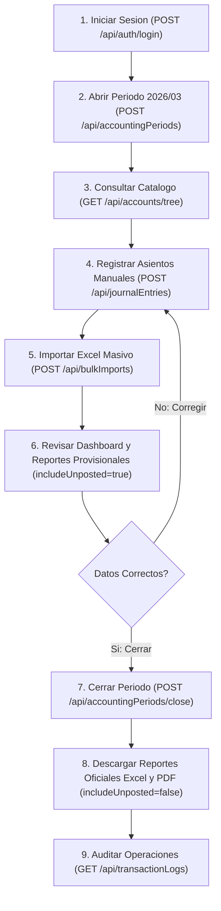

# Manual de Usuario — SBC (DataFlowHub API)

> Guía funcional y operativa para usuarios, analistas contables e integradores que operan el sistema contable **SBC (DataFlowHub API v1)** a través de sus **40 endpoints REST** distribuidos en **11 controladores**.

---

## Tabla de Contenidos

1. [Introducción, Alcance y Herramientas Cliente](#1-introducción-alcance-y-herramientas-cliente)
2. [Primeros Pasos y Autenticación](#2-primeros-pasos-y-autenticación)
3. [Convenciones de Uso de la API y Formatos de Respuesta](#3-convenciones-de-uso-de-la-api-y-formatos-de-respuesta)
4. [Guía Detallada por Módulo (10 Módulos / 40 Endpoints)](#4-guía-detallada-por-módulo-10-módulos--40-endpoints)
   - [4.1 Autenticación (`/api/auth` — 3 endpoints)](#41-autenticación-apiauth--3-endpoints)
   - [4.2 Gestión de Usuarios (`/api/users` — 5 endpoints)](#42-gestión-de-usuarios-apiusers--5-endpoints)
   - [4.3 Catálogo de Cuentas (`/api/accounts` — 6 endpoints)](#43-catálogo-de-cuentas-apiaccounts--6-endpoints)
   - [4.4 Períodos Contables y Cierre de Período (`/api/accountingPeriods` — 4 endpoints)](#44-períodos-contables-y-cierre-de-período-apiaccountingperiods--4-endpoints)
   - [4.5 Asientos Contables (`/api/journalEntries` — 5 endpoints)](#45-asientos-contables-apijournalentries--5-endpoints)
   - [4.6 Líneas de Asiento (`/api/journalEntryLines` — 6 endpoints)](#46-líneas-de-asiento-apijournalentrylines--6-endpoints)
   - [4.7 Carga Masiva desde Excel (`/api/bulkImports` — 3 endpoints)](#47-carga-masiva-desde-excel-apibulkimports--3-endpoints)
   - [4.8 Reportes Financieros JSON, Excel y PDF (`/api/reports` y `/api/financialReports` — 6 endpoints)](#48-reportes-financieros-json-excel-y-pdf-apireports-y-apifinancialreports--6-endpoints)
   - [4.9 Dashboard Ejecutivo (`/api/dashboard/summary` — 1 endpoint)](#49-dashboard-ejecutivo-apidashboardsummary--1-endpoint)
   - [4.10 Bitácora de Auditoría (`/api/transactionLogs` — 1 endpoint)](#410-bitácora-de-auditoría-apitransactionlogs--1-endpoint)
5. [Tutorial Completo: Ciclo Contable Mensual de Principio a Fin](#5-tutorial-completo-ciclo-contable-mensual-de-principio-a-fin)
6. [Catálogo de Mensajes de Error Comunes y Soluciones](#6-catálogo-de-mensajes-de-error-comunes-y-soluciones)
7. [Glosario Contable y Técnico](#7-glosario-contable-y-técnico)

---

## 1. Introducción, Alcance y Herramientas Cliente

### ¿Qué permite hacer SBC?

**SBC (DataFlowHub API)** es un sistema backend REST de contabilidad general basado en partida doble que permite:

- Administrar usuarios, credenciales y sesiones mediante **JWT Bearer + Refresh Token**.
- Gestionar un **catálogo jerárquico de cuentas** (con 145 cuentas contables precargadas).
- Controlar el ciclo operativo mensual mediante **períodos contables** (apertura, control de registro y **cierre mensual** con mayorización automática y asiento de cierre `CIE-YYYY-MM`).
- Registrar, consultar, editar y eliminar **asientos contables** y sus **líneas**, validando automáticamente la partida doble y la inmutabilidad de los asientos mayorizados.
- Realizar **importaciones masivas de asientos desde Excel** (`.xlsx`/`.xlsm`) y descargar una plantilla lista para usar.
- Emitir **Estados Financieros** (*Estado de Resultados* y *Balance General*) en modo oficial o provisional (`includeUnposted=true`) en formatos **JSON, Excel (`.xlsx`) y PDF (A4)**.
- Consultar un **Dashboard Ejecutivo** con indicadores contables en tiempo real.
- Auditar cada operación del sistema en la **Bitácora de Transacciones (`TransactionLogs`)**.

> [!NOTE]
> **Alcance orientado a API REST:** Este repositorio contiene únicamente el servicio backend REST (`DataFlowHub API`), sin aplicación frontend integrada (aunque CORS autoriza `http://localhost:5173` para clientes locales). Todas las operaciones descritas en este manual se ejecutan mediante solicitudes HTTP hacia la URL base del servidor (en desarrollo local: `http://localhost:5164` o `https://localhost:7182`; en Docker: `http://localhost:8080`).

### Roles y Autorización

La base de datos define únicamente dos roles semilla:

| Rol | ID Semilla | Asignación por Defecto | Comportamiento Actual de Autorización |
| :--- | :--- | :--- | :--- |
| **`Admin`** | `8bc2bfc1-1e12-4b5f-a1ff-679b06b1996b` | Usuario semilla `admin` o asignación explícita en `/api/users` | Acceso completo a todos los endpoints protegidos. |
| **`Guest`** | `15babe3a-44b5-4045-81b2-d1e4ef87ce32` | Auto-registro (`POST /api/auth/register`) o cuando `roles` se envía vacío `[]` en `/api/users` | Acceso a todos los endpoints marcados con `[Authorize]`. |

> [!WARNING]
> En la versión actual de la API, los 10 controladores protegidos (incluido `UsersController`) utilizan `[Authorize]` sin filtro por rol específico (`[Authorize(Roles = "Admin")]` se encuentra comentado en `UsersController`). Por tanto, cualquier usuario autenticado puede invocar cualquier endpoint protegido.

### Herramientas Cliente Recomendadas

| Herramienta | Cuándo Usarla | Notas Importantes para SBC |
| :--- | :--- | :--- |
| **`SBC.Api/SBC.Api.http`** *(JetBrains Rider, Visual Studio, VS Code REST Client)* | Pruebas rápidas dentro del repositorio. | Contiene **35 de los 40 endpoints** con scripts de captura automática de `auth_token` y `refresh_token` *(sintaxis `> ` de JetBrains Rider; en VS Code/Visual Studio descomente `@SBC_HostAddress` en la línea 1 o defina su archivo de entorno)*. **Faltan 5 endpoints**: `GET /api/users/{userId}` y las 4 descargas binarias de `/api/financialReports/*`. Además, el ejemplo `PUT /api/users/{userId}` incluye el rol inexistente `"Manager"`: **reemplácelo por `"Admin"` o `"Guest"`** antes de ejecutarlo. |
| **Postman / Insomnia** | Operación cotidiana, gestión de entornos y descarga de archivos `.xlsx`/`.pdf`. | Configure una variable de entorno `baseUrl` y `token`, y use *Send and Download* para descargas binarias. |
| **`curl` (CLI)** | Automatización, scripts y verificación en servidores. | Use `-o archivo.xlsx` o `-o archivo.pdf` al consumir `/api/bulkImports/template` y `/api/financialReports/*`. |
| **Swagger UI (`/swagger`)** | Consulta de esquemas de DTOs en modo `Development`. | **Limitación:** Swagger UI está activo solo en `Development` y actualmente **no muestra botón `Authorize` Bearer**, por lo que no permite enviar la cabecera `Authorization` desde la interfaz web. Úselo como referencia de contratos y pruebe `/api/auth/*` o use otro cliente para endpoints protegidos. |

---

## 2. Primeros Pasos y Autenticación

Todos los endpoints del sistema **excepto los 3 de `/api/auth`** requieren un token JWT válido en la cabecera HTTP:

```http
Authorization: Bearer <TU_JWT_TOKEN>
```

### Política de Contraseñas y Cuentas de Usuario

Al registrar o crear usuarios (configurada en ASP.NET Core Identity):
- **Longitud mínima:** **6 caracteres**.
- **Obligatorios:** al menos **1 dígito** (`0`–`9`) y al menos **1 letra minúscula** (`a`–`z`).
- **Opcionales (no exigidos):** mayúsculas y caracteres especiales.
- **Unicidad:** tanto `email` como `userName` deben ser únicos en el sistema.

### Flujo de Autenticación

1. **Registrar usuario** (`POST /api/auth/register` — público, asigna rol `Guest`):
   ```json
   {
     "userName": "contador1",
     "email": "contador1@miempresa.com",
     "password": "clave2026",
     "firstName": "Ana",
     "lastName": "López"
   }
   ```
   Responde `201 Created` con el `Guid` del nuevo usuario en `data`.

2. **Iniciar sesión** (`POST /api/auth/login` — público):
   > [!IMPORTANT]
   > El inicio de sesión autentica por **`userName`**, **no** por correo electrónico (`email`).

   ```json
   {
     "userName": "contador1",
     "password": "clave2026"
   }
   ```
   Responde `200 OK` con:
   ```json
   {
     "data": {
       "userId": "3fa85f64-5717-4562-b3fc-2c963f66afa6",
       "userName": "contador1",
       "email": "contador1@miempresa.com",
       "token": "eyJhbGciOiJIUzI1NiIs...",
       "refreshToken": "8f3aK9...",
       "roles": ["Guest"]
     },
     "message": null,
     "statusCode": 200,
     "success": true
   }
   ```

3. **Vigencia y renovación de sesión (`POST /api/auth/refresh-token`):**
   - El **JWT (`token`)** expira en **1 hora** (UTC).
   - El **Refresh Token (`refreshToken`)** expira en **7 días** (UTC).
   - Cuando el JWT expire (el servidor responde `401 Unauthorized`), envíe el par `(token, refreshToken)` a `POST /api/auth/refresh-token` para recibir un nuevo JWT y un nuevo Refresh Token rotado (el anterior queda invalidado inmediatamente):
     ```json
     {
       "token": "<JWT_ACTUAL_O_EXPIRADO>",
       "refreshToken": "<REFRESH_TOKEN_VIGENTE>"
     }
     ```

---

## 3. Convenciones de Uso de la API y Formatos de Respuesta

### Envoltura Estándar de Respuestas Exitosas

- **Consultas y creaciones JSON (`200 OK`, `201 Created`):** siempre devuelven `SbcGenericResponse<T>`:
  ```json
  {
    "data": { },
    "message": null,
    "statusCode": 200,
    "success": true
  }
  ```
- **Actualizaciones y eliminaciones (`PUT`, `DELETE`):** devuelven **`204 No Content`** sin cuerpo.
- **Descargas binarias (`GET /api/bulkImports/template` y `/api/financialReports/*`):** devuelven directamente el archivo `.xlsx` o `.pdf` con cabecera `Content-Disposition: attachment` (sin envoltura JSON).
- **Rutas:** el enrutamiento ASP.NET Core no distingue mayúsculas de minúsculas (`/api/journalEntries` y `/api/JournalEntries` son equivalentes).

### Los 5 Formatos Reales de Respuesta de Error

Al integrar un cliente o depurar errores, tenga en cuenta que la API puede devolver **5 estructuras distintas** según la capa donde ocurra el fallo:

| # | Formato / Content-Type | Códigos HTTP | Cuándo Ocurre | Ejemplo de Respuesta |
| :-: | :--- | :---: | :--- | :--- |
| **1** | **`SbcGenericResponse`** (`application/json`) | `400`, `401`, `404` | Errores de negocio (`DomainException` → `400`), recursos inexistentes (`NotFoundException` / `SbcException(404)` → `404`), login/refresh inválido (`401` desde `AuthController`) o excepciones no controladas dentro de `ExecuteServiceAsync` (`400`). | `{"message":"El asiento no cumple con el principio de partida doble.","statusCode":400,"success":false}` |
| **2** | **`ProblemDetails`** (`application/problem+json`) | `412` | Precondiciones fallidas (`SbcException(PreconditionFailed)`): correo/usuario duplicado o error de Identity al registrar/crear/editar usuarios o cambiar contraseñas. | `{"type":"https://tools.ietf.org/html/rfc9110#section-15.5.13","title":"Precondition Failed","status":412,"detail":"El correo electrónico ya está registrado."}` |
| **3** | **`ValidationProblemDetails`** (`application/problem+json`) | `400` | Validación automática de `[ApiController]`: JSON mal formado, campos requeridos nulos/ausentes (como omitir `"roles"` en `POST /api/users` u **omitir el campo `file`** en `POST /api/bulkImports`), GUID inválido o fecha no parseable. | `{"title":"One or more validation errors occurred.","status":400,"errors":{"Roles":["The Roles field is required."]}}` |
| **4** | **Sin cuerpo + `WWW-Authenticate: Bearer`** | `401` | Middleware JWT en endpoints `[Authorize]`: cabecera `Authorization` ausente, token expirado, firma inválida o `Issuer`/`Audience` incorrectos. | *(Cuerpo vacío; revise la cabecera `WWW-Authenticate`)* |
| **5** | **Texto plano (`400`) o `500 Internal Server Error`** | `400` / `500` | • `POST /api/bulkImports` cuando el campo `file` se envía con un **archivo vacío de 0 bytes** (`file.Length == 0`) devuelve texto plano `400`: `"No se ha proporcionado un archivo o el archivo está vacío."` *(si se omite el campo `file`, responde Formato #3 `ValidationProblemDetails`)*.<br>• Las descargas binarias (`GET /api/bulkImports/template` y `/api/financialReports/*`) no usan `ExecuteServiceAsync`, por lo que una excepción inesperada devuelve `500`. | `"No se ha proporcionado un archivo o el archivo está vacío."` |

### Paginación y Filtrado (`PagedResultDto<T>`)

Los listados paginados (`GET /api/users`, `/api/journalEntries`, `/api/journalEntryLines`, `/api/bulkImports`, `/api/transactionLogs`) aceptan `pageNumber` (defecto **`1`**) y `pageSize` (defecto **`10`**) y retornan:

```json
{
  "data": {
    "items": [ ],
    "totalCount": 42,
    "pageNumber": 1,
    "pageSize": 10,
    "totalPages": 5
  },
  "message": null,
  "statusCode": 200,
  "success": true
}
```

> [!WARNING]
> Envíe siempre **`pageNumber >= 1`** y **`pageSize >= 1`**. Enviar `pageSize=0` con `pageNumber >= 1` no lanza excepción, sino que devuelve `200 OK` con `items: []` y un valor anómalo en `totalPages` (`2147483647` si `totalCount > 0`, o `0` si `totalCount == 0` debido al cálculo en punto flotante `(int)Math.Ceiling((double)TotalCount / PageSize)`). Por su parte, enviar `pageNumber <= 0` con `pageSize >= 1` genera un `OFFSET` negativo en SQL Server y falla con `400 Bad Request` *(solo `pageNumber=0&pageSize=0` tiene manejo especial en `GET /api/users`)*.

### Catálogo de Enums

En los **cuerpos JSON** (`POST`/`PUT`) y en las **respuestas JSON**, los enums se serializan y deben enviarse como **enteros**. En parámetros de **query string** (como `?status=Success` en `/api/transactionLogs`), ASP.NET Core acepta tanto el nombre textual como el valor numérico.

#### `AccountType` (Tipo de Cuenta)

| Valor | Nombre | Español | Naturaleza de Saldo | Fórmula de Saldo | Estado Financiero |
| :---: | :--- | :--- | :--- | :---: | :--- |
| **`1`** | `Asset` | Activo | Deudora | `Debe - Haber` | Balance General |
| **`2`** | `Liability` | Pasivo | Acreedora | `Haber - Debe` | Balance General |
| **`3`** | `Equity` | Patrimonio | Acreedora | `Haber - Debe` | Balance General |
| **`4`** | `Revenue` | Ingresos | Acreedora | `Haber - Debe` | Estado de Resultados |
| **`5`** | `Cost` | Costos | Deudora | `Debe - Haber` | Estado de Resultados |
| **`6`** | `Expense` | Gastos | Deudora | `Debe - Haber` | Estado de Resultados |

#### `TransactionStatus` (Estado de Auditoría)

| Valor | Nombre | Significado |
| :---: | :--- | :--- |
| **`0`** | `Success` | Operación completada correctamente. |
| **`1`** | `Failure` | Error de ejecución, recurso no encontrado o fallo total de carga masiva. |
| **`2`** | `ValidationError` | Regla de negocio o validación incumplida (partida doble, período cerrado, código duplicado, etc.). |
| **`3`** | `PartialSuccess` | Carga masiva completada parcialmente (al menos un asiento guardado y uno o más errores). |

### Regla Operativa Crítica de Fechas (`DateTime`)

> [!IMPORTANT]
> Todos los rangos de fecha en repositorios y cierres se evalúan mediante comparación inclusiva exacta (`Date >= startDate && Date <= endDate`) sobre columnas SQL `datetime2`:
> 1. **Registre siempre los asientos contables con hora `00:00:00`** (por ejemplo, `"2026-03-31T00:00:00"`). Durante el cierre de período (`POST /api/accountingPeriods/close`), el sistema calcula `endDate` como el último día del mes a las `00:00:00`; un asiento fechado `2026-03-31T14:30:00` quedaría **fuera** de la mayorización y del Estado de Resultados de cierre.
> 2. **Al filtrar por `toDate` en `GET /api/bulkImports` y `GET /api/transactionLogs`**, incluya la hora final del día (`toDate=2026-03-31T23:59:59`), ya que `CreatedAt` y `LogDate` guardan hora, minutos y segundos. Recuerde que `TransactionLogs.LogDate` se almacena en **UTC**.
> 3. **Especifique siempre las fechas en reportes financieros** (`startDate`/`endDate` y `date`): al ser tipos de valor `DateTime`, omitirlos no devuelve error, sino que consulta `0001-01-01` devolviendo reportes vacíos.

---

## 4. Guía Detallada por Módulo (10 Módulos / 40 Endpoints)

### 4.1 Autenticación (`/api/auth` — 3 endpoints)

*Controlador público (no requiere cabecera `Authorization`).*

| Método | Ruta | Cuerpo / Parámetros | Respuesta Exitosa |
| :---: | :--- | :--- | :--- |
| `POST` | `/api/auth/register` | `RegisterDto`: `userName`, `email`, `password`, `firstName`, `lastName` | `201 Created` → `SbcGenericResponse<Guid>` |
| `POST` | `/api/auth/login` | `LoginDto`: `userName`, `password` | `200 OK` → `SbcGenericResponse<AuthResponseDto>` |
| `POST` | `/api/auth/refresh-token` | `RefreshTokenRequestDto`: `token`, `refreshToken` | `200 OK` → `SbcGenericResponse<AuthResponseDto>` |

**Reglas clave:**
- `POST /api/auth/register` asigna automáticamente el rol `"Guest"`.
- Errores de duplicidad o política de contraseñas devuelven **`412 Precondition Failed`** (`ProblemDetails`).
- Credenciales inválidas o refresh token inválido/expirado devuelven **`401 Unauthorized`** (`SbcGenericResponse`).

---

### 4.2 Gestión de Usuarios (`/api/users` — 5 endpoints)

*Requiere JWT Bearer (`[Authorize]`). No existe endpoint `DELETE` para eliminar usuarios.*

| Método | Ruta | Parámetros / Cuerpo | Respuesta Exitosa |
| :---: | :--- | :--- | :--- |
| `GET` | `/api/users` | Query (`UserFilterDto`): `pageNumber`, `pageSize`, `userName`, `email`, `firstName`, `lastName` | `200 OK` → `PagedResultDto<UserDto>` |
| `GET` | `/api/users/{userId}` | Ruta: `userId` (`guid`) | `200 OK` → `UserDto` |
| `POST` | `/api/users` | Body (`CreateUserDto`): `userName`, `email`, `password`, `firstName`, `lastName`, `roles` | `201 Created` → `Guid` |
| `PUT` | `/api/users/{userId}` | Ruta: `userId` (`guid`) · Body (`UpdateUserDto`): `userName`, `email`, `firstName`, `lastName`, `roles` | `204 No Content` |
| `PUT` | `/api/users/{userId}/password` | Ruta: `userId` (`guid`) · Body (`UpdatePasswordDto`): `currentPassword`, `newPassword` | `204 No Content` |

**Comportamientos y advertencias importantes:**
1. **Campo `roles` obligatorio en `POST` y `PUT`:** Al ser un `List<string>` no nulo, debe incluir siempre la propiedad `"roles"`. Para asignar el rol predeterminado `"Guest"`, envíe un arreglo vacío: `"roles": []`.
2. **Solo utilice roles existentes (`"Admin"` o `"Guest"`):** Enviar un rol inexistente (como `"Manager"`) hace que ASP.NET Core Identity lance `InvalidOperationException` (`"Role MANAGER does not exist."`), devolviendo **`400 Bad Request` (`SbcGenericResponse`, no `412`)** sin registrar el fallo en `TransactionLogs`: en `POST /api/users` falla *después* de haber persistido el usuario en base de datos (dejándolo con `"roles": []`), y en `PUT /api/users/{userId}` falla *después* de haber removido sus roles previos (dejándolo sin roles).
3. **Caso especial `pageNumber=0&pageSize=0` en `GET /api/users`:** Devuelve todos los usuarios en una sola página, pero **ignora** los filtros `userName`, `email`, `firstName` y `lastName`. Use `pageNumber >= 1` y `pageSize >= 1` para filtrar.
4. **Auditoría:** Las operaciones `POST` y `PUT` registran eventos en `TransactionLogs` (`CreateUser`, `UpdateUser`, `UpdatePassword`). Las consultas `GET /api/users` y `GET /api/users/{userId}` actualmente **no** generan registros en `TransactionLogs`.

**Ejemplo (`POST /api/users`):**
```json
{
  "userName": "auditor1",
  "email": "auditor1@miempresa.com",
  "password": "Audit2026",
  "firstName": "Carlos",
  "lastName": "Mendoza",
  "roles": ["Admin"]
}
```

---

### 4.3 Catálogo de Cuentas (`/api/accounts` — 6 endpoints)

*Requiere JWT Bearer. Las vistas de listado devuelven el catálogo completo ordenado ascendentemente por `code` (no paginadas).*

| Método | Ruta | Parámetros / Cuerpo | Respuesta Exitosa |
| :---: | :--- | :--- | :--- |
| `GET` | `/api/accounts` | — | `200 OK` → `IEnumerable<AccountDto>` (lista plana) |
| `GET` | `/api/accounts/tree` | — | `200 OK` → `IEnumerable<AccountDto>` (árbol jerárquico en `children`) |
| `GET` | `/api/accounts/{id}` | Ruta: `id` (`guid`) | `200 OK` → `AccountDto` (`404` si no existe) |
| `POST` | `/api/accounts` | Body (`CreateAccountDto`): `code`, `name`, `type` (`1`–`6`), `parentAccountId` (`guid?`) | `201 Created` → `AccountDto` |
| `PUT` | `/api/accounts/{id}` | Ruta: `id` (`guid`) · Body (`UpdateAccountDto`): `code`, `name`, `type` (`1`–`6`), `parentAccountId` (`guid?`) | `204 No Content` |
| `DELETE` | `/api/accounts/{id}` | Ruta: `id` (`guid`) | `204 No Content` |

**Restricciones de dominio y base de datos:**
- `code`: obligatorio, no vacío, **único**, máximo **20 caracteres** (`varchar(20)`). Si ya existe, devuelve `400`: `"La cuenta con código {code} ya existe."`.
- `name`: obligatorio, no vacío, **único**, máximo **100 caracteres** (`varchar(100)`).
- `type`: entero del `1` al `6` (`AccountType`). En las respuestas se devuelve tanto `type` (entero) como `typeName` (texto, p. ej. `"Asset"`).
- `parentAccountId`: opcional (`null` para cuentas raíz); si se proporciona, debe existir en `accounting.Accounts`.
- **Eliminación (`DELETE`):** bloqueada si la cuenta tiene subcuentas (`400`: `"No se puede eliminar una cuenta que tiene subcuentas."`) o si está referenciada en alguna línea de asiento contable (restricción `FK` con `Restrict`).

#### Resumen del Catálogo Semilla (145 Cuentas) y GUIDs de Referencia Frecuentes

La base de datos incluye **145 cuentas** precargadas (50 Activos, 42 Pasivos, 17 Patrimonio, 5 Ingresos, 5 Costos y 26 Gastos) con identificadores GUID determinísticos. A continuación, las cuentas hoja más utilizadas en operación y tutoriales:

| Código | Nombre en Catálogo Semilla | Tipo (`type`) | GUID Determinístico (`accountId`) |
| :--- | :--- | :---: | :--- |
| `1.1.1.1.001` | `CAJA GENERAL` | `1` (`Asset`) | `a52e29a6-cdb3-9e51-d93d-29cc07a883f0` |
| `1.1.1.1.002` | `CAJA CHICA` | `1` (`Asset`) | `dbb04a13-bfcb-8e76-7837-d9bc42513c15` |
| `1.1.1.2.001` | `EMPRESA X CTA.CTE.#10012705215805` | `1` (`Asset`) | `c695234b-de5d-e1c5-d9e1-d15e752bfaa2` |
| `1.1.2.1.001` | `CUENTAS POR COBRAR CLIENTES` | `1` (`Asset`) | `97434d56-efd7-d685-1bae-80c351fca817` |
| `2.1.1.2.001` | `PROVEEDOR X CXP` | `2` (`Liability`) | `c3eb59ee-e0b2-b98f-a474-e2075e164b8b` |
| `3.1.1.1.001` | `CAPITAL NEGOCIO X` | `3` (`Equity`) | `d0dd85ee-228b-9388-2484-985e2589052a` |
| `3.1.3.2.001` | `UTILIDADES DE EJERCICIO` *(cierre)* | `3` (`Equity`) | `a7716697-fbbf-6e26-bcbc-41a6f4eb3b84` |
| `4.1.1.1.001` | `VENTAS GENERALES` | `4` (`Revenue`) | `27be1f94-a9a8-fa73-c98e-33b275b550f6` |
| `5.1.1.1.001` | `COSTO GRANOS BASICO` | `5` (`Cost`) | `ba20cb9d-8cfe-6b83-1cc0-a72fb3e48c23` |
| `6.1.1.1.001` | `SUELDOS Y SALARIOS ADMON` | `6` (`Expense`) | `40f69734-81c9-7422-f498-60850cb237e6` |
| `6.1.4.2.01` | `CONS.ENEGIA ENEL GEN` | `6` (`Expense`) | `21e7b256-5e0f-2a49-9282-1735e7c895b6` |

---

### 4.4 Períodos Contables y Cierre de Período (`/api/accountingPeriods` — 4 endpoints)

*Requiere JWT Bearer. Ningún asiento puede crearse ni editarse si no existe un período abierto (`isClosed = false`) para el año y mes de la fecha del asiento.*

| Método | Ruta | Parámetros / Cuerpo | Respuesta Exitosa |
| :---: | :--- | :--- | :--- |
| `GET` | `/api/accountingPeriods` | — | `200 OK` → `IEnumerable<AccountingPeriodDto>` |
| `GET` | `/api/accountingPeriods/{year}/{month}` | Ruta: `year` (`int`), `month` (`int`) | `200 OK` → `AccountingPeriodDto` |
| `POST` | `/api/accountingPeriods` | Body (`CreateAccountingPeriodRequest`): `year`, `month` | `201 Created` → `AccountingPeriodDto` |
| `POST` | `/api/accountingPeriods/close` | Body (`ClosePeriodRequest`): `year`, `month`, `equityAccountId` | `201 Created` → `AccountingPeriodDto` |

**Comportamiento detallado:**
- **Apertura (`POST /api/accountingPeriods`):** exige `year >= 1900`, `1 <= month <= 12` y unicidad por `(year, month)`. Si ya existe, responde `400`: `"El período {month}/{year} ya existe."`.
- **Consulta por año/mes (`GET /api/accountingPeriods/{year}/{month}`):** si el período no existe, el controlador devuelve **`400 Bad Request`** (`"Periodo no encontrado"`) en lugar de `404`.
- **Proceso de Cierre (`POST /api/accountingPeriods/close`):**
  1. Verifica que el período no esté cerrado (`400`: `"El período {month}/{year} ya se encuentra cerrado."`). *(Si el período nunca fue abierto previamente, el proceso igualmente lo crea en estado cerrado.)*
  2. Verifica que `equityAccountId` exista en el catálogo (`404` si no existe). **Importante:** el servicio no restringe el `AccountType` de `equityAccountId`, por lo que el operador debe asegurarse de indicar una cuenta de **Patrimonio** (recomendada: `3.1.3.2.001 UTILIDADES DE EJERCICIO`, GUID `a7716697-fbbf-6e26-bcbc-41a6f4eb3b84`).
  3. **Mayorización automática:** marca `isPosted = true` en todos los asientos con fecha entre el día 1 (`00:00:00`) y el último día del mes (`00:00:00`). Desde este momento dichos asientos son **inmutables**.
  4. **Generación del asiento de cierre `CIE-YYYY-MM`:** calcula el Estado de Resultados del mes.
     - Si no existen movimientos de Ingresos, Costos ni Gastos (`netIncome == 0` y listas vacías), cierra el período sin crear asiento (`closingJournalEntryId: null`).
     - En caso contrario, genera el asiento **`CIE-YYYY-MM`** (con `isPosted = true`, fecha del último día del mes y descripción `"Asiento de Cierre Contable - Periodo {month}/{year}"`):
       - **Ingresos:** se debitan para dejar su saldo en cero.
       - **Costos y Gastos:** se acreditan para dejar su saldo en cero.
       - **Resultado del ejercicio (`netIncome`):** si hay **utilidad (`> 0`)**, se acredita `equityAccountId`; si hay **pérdida (`< 0`)**, se debita `equityAccountId`.
  5. Marca el período como `isClosed = true` y guarda `closedAt` y `closingJournalEntryId` *(además del evento `CloseAccountingPeriod`, el cálculo interno del Estado de Resultados registra también un evento `GenerateIncomeStatement` en `TransactionLogs`)*.

> [!WARNING]
> **Consideraciones críticas sobre el cierre de período:**
> - **Irreversibilidad:** no existe endpoint para reabrir un período cerrado.
> - **Fecha con hora `00:00:00`:** asientos registrados el último día del mes con hora mayor a `00:00:00` quedarán excluidos de la mayorización y del cierre.
> - **Saldos contrarios (negativos) en cuentas de resultados y ausencia de transacción SQL:** como la tabla `JournalEntryLines` exige `Debit >= 0` y `Credit >= 0`, si una cuenta de Ingreso, Costo o Gasto termina el mes con saldo neto negativo (contrario a su naturaleza), la inserción del asiento `CIE-YYYY-MM` fallará por restricción `CHECK` en SQL Server. Dado que `ClosePeriodAsync` mayoriza y guarda cada asiento (`isPosted = true`) **antes** de insertar `CIE-YYYY-MM` sin una transacción envolvente, ante ese fallo los asientos del mes ya habrán quedado marcados como `isPosted = true` aunque el período permanezca abierto. Reclasifique o regularice cualquier saldo contrario antes de ejecutar el cierre.
> - **Campo `closedBy`:** en la implementación actual, `AccountingPeriodDto.closedBy` queda `null` al cerrar (el usuario que ejecutó la operación queda registrado en auditoría `TransactionLogs` y en la columna interna `UpdatedBy`/`CreatedBy`).

---

### 4.5 Asientos Contables (`/api/journalEntries` — 5 endpoints)

*Requiere JWT Bearer.*

| Método | Ruta | Parámetros / Cuerpo | Respuesta Exitosa |
| :---: | :--- | :--- | :--- |
| `GET` | `/api/journalEntries` | Query (`JournalEntryFilterDto`): `pageNumber`, `pageSize`, `searchTerm`, `fromDate`, `toDate`, `isPosted` | `200 OK` → `PagedResultDto<JournalEntryDto>` |
| `GET` | `/api/journalEntries/{id}` | Ruta: `id` (`guid`) | `200 OK` → `JournalEntryDto` (`404` si no existe) |
| `POST` | `/api/journalEntries` | Body (`CreateJournalEntryDto`): `date`, `description`, `lines[]` | `201 Created` → `JournalEntryDto` |
| `PUT` | `/api/journalEntries/{id}` | Ruta: `id` (`guid`) · Body (`UpdateJournalEntryDto`): `date`, `description`, `lines[]` | `204 No Content` |
| `DELETE` | `/api/journalEntries/{id}` | Ruta: `id` (`guid`) | `204 No Content` |

**Reglas contables y de validación:**
- **Código automático:** se genera en formato secuencial **`YYYY-MM-0001`** por año y mes (ej. `2026-03-0001`, `2026-03-0002`).
- **Período abierto obligatorio:** en `POST` y `PUT` se valida que exista un período abierto para `date.Year`/`date.Month` (`400`: `"No existe un periodo contable abierto para {mes año}."`, donde `{mes año}` sigue la cultura del servidor, p. ej. `marzo 2026` o `March 2026`).
- **Partida doble obligatoria:** `Sum(lines.debit) == Sum(lines.credit)` (`400`: `"El asiento no cumple con el principio de partida doble."`).
- **Montos y restricciones SQL:** cada línea almacena `debit` y `credit` como `money` (hasta 4 decimales), exige `debit >= 0`, `credit >= 0` y al menos uno mayor que cero (`debit > 0 OR credit > 0`).
- **Descripción:** obligatoria en práctica (no envíe `""` ni la omita; la restricción SQL `CK_JournalEntries_Description_NotEmpty` rechaza cadenas vacías y limita a **255 caracteres**).
- **Inmutabilidad:** si `isPosted == true`, tanto `PUT` (`"No se puede editar un asiento que ya ha sido mayorizado."`) como `DELETE` (`"No se puede eliminar un asiento que ya ha sido mayorizado."`) responden `400`.
- **Edición de líneas con `PUT /api/journalEntries/{id}`:** sincroniza la lista completa *(si cambia `date` a otro mes/año, valida que el nuevo período esté abierto, pero conserva el `code` original sin regenerarlo)*:
  - Líneas con `id` coincidente con una línea existente → se actualizan.
  - Líneas existentes omitidas del arreglo `lines` → se eliminan.
  - Líneas sin `id` (o con `id: null`) → se agregan como líneas nuevas.
- **Eliminación (`DELETE`):** elimina el asiento y en cascada todas sus líneas.
- **Filtros de `GET /api/journalEntries`:** `searchTerm` busca coincidencias parciales en `description` o `code`; ordenado por `date DESC, code DESC`.

**Ejemplo (`POST /api/journalEntries`):**
```json
{
  "date": "2026-03-10T00:00:00",
  "description": "Venta de mercadería al contado",
  "lines": [
    {
      "accountId": "a52e29a6-cdb3-9e51-d93d-29cc07a883f0",
      "debit": 2500.00,
      "credit": 0
    },
    {
      "accountId": "27be1f94-a9a8-fa73-c98e-33b275b550f6",
      "debit": 0,
      "credit": 2500.00
    }
  ]
}
```

---

### 4.6 Líneas de Asiento (`/api/journalEntryLines` — 6 endpoints)

*Requiere JWT Bearer.*

| Método | Ruta | Parámetros / Cuerpo | Respuesta Exitosa |
| :---: | :--- | :--- | :--- |
| `GET` | `/api/journalEntryLines` | Query (`JournalEntryLineFilterDto`): `pageNumber`, `pageSize`, `accountId`, `fromDate`, `toDate`, `minAmount`, `maxAmount` | `200 OK` → `PagedResultDto<JournalEntryLineDto>` |
| `GET` | `/api/journalEntryLines/{id}` | Ruta: `id` (`guid`) | `200 OK` → `JournalEntryLineDto` (`404` si no existe) |
| `GET` | `/api/journalEntryLines/journal-entry/{journalEntryId}` | Ruta: `journalEntryId` (`guid`) | `200 OK` → `IEnumerable<JournalEntryLineDto>` |
| `POST` | `/api/journalEntryLines` | Body (`CreateJournalEntryLineForLineDto`): `journalEntryId`, `accountId`, `debit`, `credit` | `201 Created` → `JournalEntryLineDto` |
| `PUT` | `/api/journalEntryLines/{id}` | Ruta: `id` (`guid`) · Body (`UpdateJournalEntryLineForLineDto`): `accountId`, `debit`, `credit` | `204 No Content` |
| `DELETE` | `/api/journalEntryLines/{id}` | Ruta: `id` (`guid`) | `204 No Content` |

**Reglas y particularidades importantes:**
1. **Validación inmediata de partida doble en cada llamada individual:** `POST`, `PUT` y `DELETE` sobre `/api/journalEntryLines` validan `ValidateDoubleEntry()` sobre el asiento padre en la misma solicitud. Por ello:
   - `POST` solo puede agregar una línea que por sí sola mantenga cuadrado el asiento (p. ej. `debit == credit > 0`).
   - `PUT` solo permite cambios que no descuadren el asiento (p. ej. cambiar únicamente `accountId` conservando los montos).
   - `DELETE` únicamente tiene éxito si las líneas restantes siguen cumpliendo partida doble (p. ej. al borrar una línea autocuadrada `debit == credit` o la única línea restante del asiento); en un asiento normal de dos líneas (`Debe` en una línea y `Haber` en otra), borrar una línea individual siempre fallará.
   - **Recomendación operativa:** para agregar, modificar montos o eliminar múltiples líneas de un asiento no mayorizado, utilice **`PUT /api/journalEntries/{id}`**.
2. **Asientos mayorizados:** cualquier intento de `POST`, `PUT` o `DELETE` sobre un asiento con `isPosted = true` devuelve `400 Bad Request`.
3. **Semántica de filtros `minAmount` vs `maxAmount` en `GET /api/journalEntryLines`:**
   - `minAmount` aplica **`OR`**: `debit >= minAmount || credit >= minAmount` (devuelve líneas donde el débito **o** el crédito alcance al menos `minAmount`).
   - `maxAmount` aplica **`AND`**: `debit <= maxAmount && credit <= maxAmount` (ambos lados deben ser menores o iguales a `maxAmount`).
   - El resultado se ordena por `JournalEntry.Date DESC`.

---

### 4.7 Carga Masiva desde Excel (`/api/bulkImports` — 3 endpoints)

*Requiere JWT Bearer.*

| Método | Ruta | Parámetros / Cuerpo | Respuesta Exitosa |
| :---: | :--- | :--- | :--- |
| `GET` | `/api/bulkImports` | Query (`BulkImportFilterDto`): `pageNumber`, `pageSize`, `fileName`, `fromDate`, `toDate` | `200 OK` → `PagedResultDto<BulkImportDto>` |
| `GET` | `/api/bulkImports/template` | — | `200 OK` → Archivo `PlantillaCargaMasiva.xlsx` |
| `POST` | `/api/bulkImports` | `multipart/form-data` con campo **`file`** (`.xlsx` o `.xlsm`) | `200 OK` → `SbcGenericResponse<BulkJournalEntryImportResultDto>` |

#### Descarga y Uso de la Plantilla (`GET /api/bulkImports/template`)

La plantilla genera la hoja `"Plantilla Carga Masiva"` con 6 columnas y **4 filas de prueba** (2 asientos cuadrados: `AS-001` por `5,000` en `1.1.1.1.001` / `3.1.1.1.001`, y `AS-002` por `150` en `6.1.4.2.01` / `1.1.1.2.001`) fechados con el **día actual** (`DateTime.Today`).

> [!TIP]
> Antes de subir la plantilla sin modificarla, asegúrese de tener **abierto el período contable del mes y año actuales** mediante `POST /api/accountingPeriods`; de lo contrario, las 4 filas serán rechazadas por período cerrado.

#### Especificación Estricta de Columnas (`A`–`F`) en Excel

El lector utiliza `ClosedXML` (`workbook.Worksheets.FirstOrDefault()`, saltando la fila 1 de encabezados). **Solo se admiten archivos `.xlsx` o `.xlsm`** (subir un `.xls`, `.csv` o archivo corrupto falla con `400 Bad Request` en formato `SbcGenericResponse` antes de leer filas):

| Columna | Encabezado | Tipo Obligatorio en Excel | Regla de Validación Verificada |
| :---: | :--- | :--- | :--- |
| **A** | `Fecha` | **Fecha nativa de Excel** *(nunca texto)* | Leída con `GetDateTime()`. Debe pertenecer a un período abierto. Si la celda es texto (ej. `'2026-03-10`), la fila falla con error de parseo. |
| **B** | `Descripción` | Texto | Descripción del asiento (no vacía, máx. 255 caracteres). |
| **C** | `Código de Cuenta` | Texto | Obligatorio. Debe coincidir exactamente con el `Code` de una cuenta existente en `accounting.Accounts` (ej. `1.1.1.1.001`). |
| **D** | `Debe` | **Numérico explícito** | Leído con `GetValue<decimal>()`. **Escriba `0` cuando no haya débito; nunca deje la celda vacía** (una celda en blanco lanza error de conversión). |
| **E** | `Haber` | **Numérico explícito** | Leído con `GetValue<decimal>()`. **Escriba `0` cuando no haya crédito; nunca deje la celda vacía**. |
| **F** | `Referencia de Grupo (Opcional)` | Texto *(opcional)* | Agrupa filas en un mismo asiento (ej. `AS-001`). Si se deja vacía, se agrupa automáticamente por `{Fecha:yyyyMMdd}-{Descripción}`. |

> [!IMPORTANT]
> **Filas contiguas:** todas las líneas que pertenezcan a un mismo asiento deben colocarse en **filas consecutivas** dentro de la hoja. En cuanto cambia la clave de grupo (`Columna F` o `Fecha + Descripción`), el importador cierra y valida la partida doble del asiento en curso.

#### Interpretación de Respuestas y Fallos Parciales

- **Respuesta de `POST /api/bulkImports` (`BulkJournalEntryImportResultDto`):**
  ```json
  {
    "data": {
      "successCount": 2,
      "errorCount": 1,
      "errors": [
        "Fila 6: No se encontró la cuenta con código '9.9.9.9.999'."
      ]
    },
    "message": null,
    "statusCode": 200,
    "success": true
  }
  ```
  - `successCount`: número de **asientos** (agrupados) creados exitosamente.
  - `errorCount`: cantidad total de mensajes en `errors` (errores de fila y/o asientos descuadrados).
  - **Comportamiento parcial:** los asientos válidos sí se guardan aunque otros fallen. Tenga en cuenta que si una línea de un asiento falla (por cuenta inexistente o celda vacía), las demás líneas de ese mismo asiento pueden quedar descuadradas y generar un segundo error de partida doble.
- **Historial (`GET /api/bulkImports` → `BulkImportDto`):** persiste `fileName`, `totalCount` (total de asientos agrupados intentados), `successCount`, `errorCount`, `createdAt` y `createdBy`.

---

### 4.8 Reportes Financieros JSON, Excel y PDF (`/api/reports` y `/api/financialReports` — 6 endpoints)

*Requiere JWT Bearer.*

| Método | Ruta | Parámetros Query | Formato / Archivo de Salida |
| :---: | :--- | :--- | :--- |
| `GET` | `/api/reports/income-statement` | `startDate`, `endDate`, `includeUnposted` *(defecto `false`)* | JSON → `SbcGenericResponse<IncomeStatementDto>` |
| `GET` | `/api/reports/balance-sheet` | `date`, `includeUnposted` *(defecto `false`)* | JSON → `SbcGenericResponse<BalanceSheetDto>` |
| `GET` | `/api/financialReports/income-statement/excel` | `startDate`, `endDate`, `includeUnposted` *(defecto `false`)* | Excel → `EstadoDeResultados_{yyyyMMdd}_{yyyyMMdd}.xlsx` |
| `GET` | `/api/financialReports/income-statement/pdf` | `startDate`, `endDate`, `includeUnposted` *(defecto `false`)* | PDF (A4) → `EstadoDeResultados_{yyyyMMdd}_{yyyyMMdd}.pdf` |
| `GET` | `/api/financialReports/balance-sheet/excel` | `date`, `includeUnposted` *(defecto `false`)* | Excel → `BalanceGeneral_{yyyyMMdd}.xlsx` |
| `GET` | `/api/financialReports/balance-sheet/pdf` | `date`, `includeUnposted` *(defecto `false`)* | PDF (A4) → `BalanceGeneral_{yyyyMMdd}.pdf` |

#### Modo Oficial vs. Modo Provisional (`includeUnposted`)

- **`includeUnposted=false` (por defecto — Oficial):** incluye únicamente asientos mayorizados (`isPosted = true`).
- **`includeUnposted=true` (Provisional / En vivo):** incluye también asientos pendientes de mayorizar (`isPosted = false`). En JSON retorna `"isProvisional": true`; en Excel agrega `"(Provisional)"`; en PDF muestra la etiqueta roja `"PROVISIONAL"`.

#### Fórmulas de Cálculo

Solo se listan cuentas con saldo distinto de cero (`amount != 0`), ordenadas por `accountCode`:

- **Estado de Resultados (`startDate` a `endDate`):**
  - `Ingresos (Revenue)` = `Sum(Credit - Debit)`
  - `Costos (Cost)` = `Sum(Debit - Credit)`
  - `Gastos (Expense)` = `Sum(Debit - Credit)`
  - `Utilidad Bruta (grossProfit)` = `totalRevenues - totalCosts`
  - `Utilidad Neta (netIncome)` = `grossProfit - totalExpenses`
- **Balance General (acumulado histórico desde el inicio hasta `date`):**
  - `Activos (Asset)` = `Sum(Debit - Credit)`
  - `Pasivos (Liability)` = `Sum(Credit - Debit)`
  - `Patrimonio (Equity)` = `Sum(Credit - Debit)`
  - `Utilidad del Período Histórica (netIncome)` = `Revenue - Cost - Expense` acumulados hasta `date`
  - `Total Pasivo y Patrimonio (totalLiabilitiesAndEquity)` = `totalLiabilities + totalEquity + netIncome`

> [!NOTE]
> **Diferencia de presentación de `Total Patrimonio` entre JSON y Excel/PDF (Balance General):**
> - En **JSON** (`GET /api/reports/balance-sheet`), `totalEquity` contiene **únicamente** la suma de las cuentas de tipo `Equity`, y `netIncome` viene en un campo separado (ambos se suman en `totalLiabilitiesAndEquity`).
> - En **Excel y PDF** (`GET /api/financialReports/balance-sheet/...`), la línea `"Total Patrimonio"` muestra la suma combinada **`TotalEquity + NetIncome`** (incluyendo `"Utilidad del Periodo (Histórica)"`), y `"TOTAL PASIVO Y PATRIMONIO"` coincide con `totalLiabilitiesAndEquity`.
>
> **Efecto del asiento de cierre (`CIE-YYYY-MM`) en reportes posteriores al cierre:**
> - El asiento de cierre se registra con fecha del último día del mes (`isPosted = true`) y deja en cero las cuentas de Ingresos, Costos y Gastos trasladando el resultado a `equityAccountId`. Por tanto, después de cerrar un mes:
>   - En el **Balance General** al cierre de mes, el resultado aparece dentro de `Equity` (`equityAccountId`) y `netIncome` histórico del mes cerrado pasa a `0` (manteniendo la ecuación contable cuadrada).
>   - En el **Estado de Resultados** consultado con `endDate` igual o posterior al último día del mes cerrado, las cuentas de resultados netean a `0` al incluir `CIE-YYYY-MM`. Si necesita emitir el Estado de Resultados con el detalle de ingresos, costos y gastos del mes, expórtelo **antes de cerrar el período** con `includeUnposted=true` (o consulte hasta el día previo al asiento de cierre si no hubo movimientos operativos el último día).

#### Ejemplo de Descarga Binaria (`curl`)

```bash
# Descargar Estado de Resultados oficial en PDF (A4)
curl -H "Authorization: Bearer <TOKEN>" \
  "http://localhost:5164/api/financialReports/income-statement/pdf?startDate=2026-03-01&endDate=2026-03-31&includeUnposted=false" \
  -o EstadoDeResultados_202603.pdf

# Descargar Balance General provisional en Excel
curl -H "Authorization: Bearer <TOKEN>" \
  "http://localhost:5164/api/financialReports/balance-sheet/excel?date=2026-03-31&includeUnposted=true" \
  -o BalanceGeneral_20260331.xlsx
```

---

### 4.9 Dashboard Ejecutivo (`/api/dashboard/summary` — 1 endpoint)

*Requiere JWT Bearer.*

| Método | Ruta | Parámetros | Respuesta Exitosa |
| :---: | :--- | :--- | :--- |
| `GET` | `/api/dashboard/summary` | — | `200 OK` → `SbcGenericResponse<DashboardSummaryDto>` |

**Cómo interpretar los datos devueltos:**
- **KPIs en vivo (`totalAssets`, `totalLiabilities`, `totalEquity`, `totalRevenue`, `totalCosts`, `totalExpenses`, `netIncome`):** se calculan con `includeUnposted = true` desde el inicio histórico hasta la fecha/hora actual del servidor (`DateTime.Now`). Tenga en cuenta que después de cerrar un período, el asiento `CIE-YYYY-MM` salda las cuentas de resultados contra patrimonio, lo que refleja los saldos acumulados reales a la fecha.
- **`recentMovements`:** últimos **10 asientos** ordenados por `Date DESC, Code DESC` (incluye mayorizados y no mayorizados; `totalAmount` corresponde a `Sum(Debit)`). No filtra por `Date <= DateTime.Now`, por lo que si existen asientos con fecha futura también aparecerán.
- **`topAccounts`:** las **5 cuentas con mayor número de líneas registradas** (`movementCount`) en toda la base de datos histórica (todas las fechas y estados), junto con `totalAmount = Sum(Debit + Credit)`.

---

### 4.10 Bitácora de Auditoría (`/api/transactionLogs` — 1 endpoint)

*Requiere JWT Bearer.*

| Método | Ruta | Parámetros Query | Respuesta Exitosa |
| :---: | :--- | :--- | :--- |
| `GET` | `/api/transactionLogs` | `TransactionLogFilterDto`: `pageNumber`, `pageSize`, `action`, `entityName`, `status`, `fromDate`, `toDate` | `200 OK` → `PagedResultDto<TransactionLogDto>` |

- **`action` y `entityName`:** coincidencia exacta (sensible al formato según la colación de SQL Server).
- **`status`:** acepta entero (`0`–`3`) o nombre (`Success`, `Failure`, `ValidationError`, `PartialSuccess`).
- **`fromDate` / `toDate`:** comparan contra `logDate` (almacenado en **UTC**). Incluya `T23:59:59` en `toDate` (por ejemplo, `toDate=2026-03-31T23:59:59`) para cubrir el día completo en UTC.
- Cada elemento (`TransactionLogDto`) incluye `userId`, `userEmail` (resuelto por *left join* con `identity.Users`), `action`, `entityName`, `entityId`, `details` (JSON de parámetros sin contraseñas ni tokens), `status`, `errorMessage`, `ipAddress` y `logDate` (UTC).

#### Catálogo Completo de las 28 Acciones Auditadas (`TransactionActions`)

| Categoría | Acciones (`action`) |
| :--- | :--- |
| **Autenticación (3)** | `RegisterUser`, `Login`, `RefreshToken` |
| **Usuarios (3)** | `CreateUser`, `UpdateUser`, `UpdatePassword` |
| **Catálogo de Cuentas (4)** | `GetAccounts`, `CreateAccount`, `UpdateAccount`, `DeleteAccount` |
| **Períodos Contables (3)** | `GetAccountingPeriods`, `CreateAccountingPeriod`, `CloseAccountingPeriod` |
| **Asientos Contables (4)** | `GetJournalEntries`, `CreateJournalEntry`, `UpdateJournalEntry`, `DeleteJournalEntry` |
| **Líneas de Asiento (4)** | `GetJournalEntryLines`, `CreateJournalEntryLine`, `UpdateJournalEntryLine`, `DeleteJournalEntryLine` |
| **Carga Masiva (3)** | `GetBulkImports`, `BulkImport`, `GetBulkImportTemplate` |
| **Reportes y Dashboard (3)** | `GenerateIncomeStatement`, `GenerateBalanceSheet`, `GetDashboardData` |
| **Auditoría (1)** | `GetLogs` |

> [!NOTE]
> **Particularidades actuales de auditoría:**
> - Consultar `GET /api/transactionLogs` registra automáticamente un evento `GetLogs` tras devolver la consulta.
> - Actualmente los endpoints `GET /api/journalEntries`, `GET /api/journalEntryLines` y `GET /api/bulkImports` registran **dos filas por consulta** (una emitida por el servicio y otra por `SbcControllerBase`).
> - `GET /api/users` y `GET /api/users/{userId}` no generan registros en `TransactionLogs`.
> - Los reportes JSON, Excel y PDF registran `GenerateIncomeStatement` o `GenerateBalanceSheet` con el mismo formato de `details` (sin diferenciar el tipo de archivo exportado).

---

## 5. Tutorial Completo: Ciclo Contable Mensual de Principio a Fin

El siguiente diagrama resume el ciclo operativo recomendado para un mes contable (ejemplo: **marzo de 2026**):



> [!TIP]
> Los comandos `curl` de este tutorial están escritos en sintaxis **Bash** (Linux, macOS, Git Bash o WSL). En **Windows PowerShell 5.1**, `curl` es un alias de `Invoke-WebRequest`: ejecútelos desde Git Bash/WSL, sustituya `curl` por **`curl.exe`** ajustando las comillas, o copie los cuerpos JSON directamente en Postman o [SBC.Api.http](../SBC.Api/SBC.Api.http).

### Paso 1 — Iniciar Sesión y Obtener Token

```bash
curl -X POST http://localhost:5164/api/auth/login \
  -H "Content-Type: application/json" \
  -d '{"userName":"admin_local","password":"AdminPass123"}'
```
Guarde `data.token` en la variable `TOKEN` para todos los pasos siguientes.

### Paso 2 — Abrir el Período Contable (Marzo 2026)

```bash
curl -X POST http://localhost:5164/api/accountingPeriods \
  -H "Authorization: Bearer $TOKEN" \
  -H "Content-Type: application/json" \
  -d '{"year":2026,"month":3}'
```

### Paso 3 — Consultar el Catálogo de Cuentas

```bash
curl -H "Authorization: Bearer $TOKEN" \
  "http://localhost:5164/api/accounts/tree"
```
Identifique los `id` de las cuentas a utilizar (en este tutorial usamos los GUIDs determinísticos del catálogo semilla listados en la [Sección 4.3](#43-catálogo-de-cuentas-apiaccounts--6-endpoints)).

### Paso 4 — Registrar Asientos Contables Manuales

**Asiento 1 — Aporte de capital inicial (`10,000.00`):**
```bash
curl -X POST http://localhost:5164/api/journalEntries \
  -H "Authorization: Bearer $TOKEN" \
  -H "Content-Type: application/json" \
  -d '{
    "date": "2026-03-01T00:00:00",
    "description": "Aporte inicial de capital en Caja General",
    "lines": [
      { "accountId": "a52e29a6-cdb3-9e51-d93d-29cc07a883f0", "debit": 10000.00, "credit": 0 },
      { "accountId": "d0dd85ee-228b-9388-2484-985e2589052a", "debit": 0, "credit": 10000.00 }
    ]
  }'
```

**Asiento 2 — Venta general (`4,000.00`) y Asiento 3 — Gasto de sueldos (`1,200.00`):**
```bash
curl -X POST http://localhost:5164/api/journalEntries \
  -H "Authorization: Bearer $TOKEN" \
  -H "Content-Type: application/json" \
  -d '{
    "date": "2026-03-15T00:00:00",
    "description": "Ventas del mes al contado",
    "lines": [
      { "accountId": "a52e29a6-cdb3-9e51-d93d-29cc07a883f0", "debit": 4000.00, "credit": 0 },
      { "accountId": "27be1f94-a9a8-fa73-c98e-33b275b550f6", "debit": 0, "credit": 4000.00 }
    ]
  }'

curl -X POST http://localhost:5164/api/journalEntries \
  -H "Authorization: Bearer $TOKEN" \
  -H "Content-Type: application/json" \
  -d '{
    "date": "2026-03-20T00:00:00",
    "description": "Pago de planilla administrativa",
    "lines": [
      { "accountId": "40f69734-81c9-7422-f498-60850cb237e6", "debit": 1200.00, "credit": 0 },
      { "accountId": "a52e29a6-cdb3-9e51-d93d-29cc07a883f0", "debit": 0, "credit": 1200.00 }
    ]
  }'
```

### Paso 5 — Descargar Plantilla y Ejecutar Carga Masiva (Opcional)

```bash
# 1. Descargar plantilla Excel
curl -H "Authorization: Bearer $TOKEN" \
  "http://localhost:5164/api/bulkImports/template" \
  -o PlantillaCargaMasiva.xlsx

# 2. (Opcional) Ajuste las fechas en Excel a marzo 2026 manteniendo formato Fecha y 0 en Debe/Haber
# 3. Subir archivo Excel
curl -X POST http://localhost:5164/api/bulkImports \
  -H "Authorization: Bearer $TOKEN" \
  -F "file=@PlantillaCargaMasiva.xlsx"
```

### Paso 6 — Revisar Dashboard y Reportes Provisionales (Antes del Cierre)

```bash
# Dashboard en vivo
curl -H "Authorization: Bearer $TOKEN" \
  "http://localhost:5164/api/dashboard/summary"

# Estado de Resultados provisional (incluye asientos no mayorizados)
curl -H "Authorization: Bearer $TOKEN" \
  "http://localhost:5164/api/reports/income-statement?startDate=2026-03-01&endDate=2026-03-31&includeUnposted=true"

# Balance General provisional
curl -H "Authorization: Bearer $TOKEN" \
  "http://localhost:5164/api/reports/balance-sheet?date=2026-03-31&includeUnposted=true"
```
Con los 3 asientos del Paso 4, el Estado de Resultados provisional mostrará `totalRevenues: 4000`, `totalExpenses: 1200` y `netIncome: 2800`. Si detecta un error, todavía puede editar los asientos con `PUT /api/journalEntries/{id}`.

### Paso 7 — Cerrar el Período Contable

Usamos la cuenta semilla `3.1.3.2.001 UTILIDADES DE EJERCICIO` (`a7716697-fbbf-6e26-bcbc-41a6f4eb3b84`):

```bash
curl -X POST http://localhost:5164/api/accountingPeriods/close \
  -H "Authorization: Bearer $TOKEN" \
  -H "Content-Type: application/json" \
  -d '{
    "year": 2026,
    "month": 3,
    "equityAccountId": "a7716697-fbbf-6e26-bcbc-41a6f4eb3b84"
  }'
```
El sistema mayoriza todos los asientos de marzo, crea el asiento `CIE-2026-03` trasladando `2,800.00` a `UTILIDADES DE EJERCICIO` y cierra el período.

### Paso 8 — Descargar Reportes Oficiales en Excel y PDF

```bash
# Balance General oficial al 31/03/2026 en PDF
curl -H "Authorization: Bearer $TOKEN" \
  "http://localhost:5164/api/financialReports/balance-sheet/pdf?date=2026-03-31&includeUnposted=false" \
  -o BalanceGeneral_20260331.pdf

# Balance General oficial al 31/03/2026 en Excel
curl -H "Authorization: Bearer $TOKEN" \
  "http://localhost:5164/api/financialReports/balance-sheet/excel?date=2026-03-31&includeUnposted=false" \
  -o BalanceGeneral_20260331.xlsx
```

*(Nota: tras el cierre de marzo, `CIE-2026-03` tiene fecha `2026-03-31` y salda Ingresos/Gastos en cero; por ello, si desea emitir el Estado de Resultados oficial del período con detalle de ingresos y gastos, consulte el rango previo al asiento de cierre o exporte el Estado de Resultados antes de ejecutar el cierre.)*

### Paso 9 — Auditar la Actividad en la Bitácora

```bash
curl -H "Authorization: Bearer $TOKEN" \
  "http://localhost:5164/api/transactionLogs?action=CloseAccountingPeriod&status=Success&pageNumber=1&pageSize=10"
```

---

## 6. Catálogo de Mensajes de Error Comunes y Soluciones

| Mensaje Exacto de la API | HTTP | Formato | Causa y Acción Correctiva |
| :--- | :---: | :--- | :--- |
| `"Credenciales inválidas."` | `401` | `SbcGenericResponse` | Usuario o contraseña incorrectos. Verifique que envía **`userName`** (no correo). |
| `"Token inválido."` / `"Refresh token inválido o expirado."` | `401` | `SbcGenericResponse` | El JWT está mal formado o el refresh token ya venció (7 días) o fue rotado. Vuelva a llamar a `POST /api/auth/login`. |
| `"El correo electrónico ya está registrado."` / `"El nombre de usuario ya está registrado."` | `412` | `ProblemDetails` | Ya existe otro usuario con ese correo o `userName`. Use valores únicos. |
| `"La clave secreta JWT no está configurada."` / `"IDX10653: ... requires a key size of at least '128' bits..."` | `400` | `SbcGenericResponse` | `JwtSettings:SecretKey` tiene menos de 16 bytes (128 bits) o quedó vacío tras recarga dinámica *(si está ausente o vacío al arrancar, la API devuelve `HTTP 500` antes del controlador)*. Revise [Troubleshooting](./MANUAL_INSTALACION.md#9-guía-de-solución-de-problemas-troubleshooting). |
| `"Role {ROL} does not exist."` | `400` | `SbcGenericResponse` | Se envió un nombre de rol inexistente en `POST /api/users` o `PUT /api/users/{userId}` (ej. `"Manager"`). Utilice únicamente `"Admin"` o `"Guest"`, o `"roles": []` para `"Guest"`. *(En `POST` el usuario ya quedó creado sin roles; en `PUT` se eliminaron los roles previos.)* |
| `"Usuario no encontrado."` / `"Cuenta no encontrada."` | `404` | `SbcGenericResponse` | El GUID especificado no existe en base de datos. |
| `"Entity \"JournalEntry\" ({id}) was not found."` *(o `Account` / `JournalEntryLine`)* | `404` | `SbcGenericResponse` | Identificador inexistente en la entidad indicada. |
| `"La cuenta con código {code} ya existe."` | `400` | `SbcGenericResponse` | Código de cuenta duplicado. Elija otro código único de máximo 20 caracteres. |
| `"No se puede eliminar una cuenta que tiene subcuentas."` | `400` | `SbcGenericResponse` | Elimine o reasigne primero todas las cuentas hijas antes de eliminar la cuenta padre. |
| `"El período {month}/{year} ya existe."` | `400` | `SbcGenericResponse` | El período ya fue creado anteriormente. Consúltelo con `GET /api/accountingPeriods/{year}/{month}`. |
| `"Periodo no encontrado"` | `400` | `SbcGenericResponse` | El año/mes consultado en `GET /api/accountingPeriods/{year}/{month}` aún no existe. Ábralo con `POST /api/accountingPeriods`. |
| `"El período {month}/{year} ya se encuentra cerrado."` | `400` | `SbcGenericResponse` | El período ya fue cerrado y no puede volver a cerrarse. |
| `"No existe un periodo contable abierto para {mes año}."` | `400` | `SbcGenericResponse` | No existe un período con `isClosed = false` para la fecha del asiento *(el nombre del mes depende de la cultura del servidor)*. Ábralo primero con `POST /api/accountingPeriods`. |
| `"El asiento no cumple con el principio de partida doble."` | `400` | `SbcGenericResponse` | `Sum(debit) != Sum(credit)`. Ajuste los montos para que ambas sumas coincidan exactamente. |
| `"No se puede editar un asiento que ya ha sido mayorizado."` / `"No se puede eliminar un asiento que ya ha sido mayorizado."` | `400` | `SbcGenericResponse` | El asiento tiene `isPosted = true` (mayorizado por cierre de período). Registre un asiento de ajuste en un período abierto. |
| `"La operación resultaría en un asiento que no cumple con la partida doble."` | `400` | `SbcGenericResponse` | Ocurre al crear, editar o borrar una línea individual en `/api/journalEntryLines`. Utilice `PUT /api/journalEntries/{id}` para actualizar todas las líneas juntas. |
| `"No se ha proporcionado un archivo o el archivo está vacío."` | `400` | Texto plano | En `POST /api/bulkImports` se envió el campo `file` con **0 bytes** *(si se omite el campo `file`, responde `400` `ValidationProblemDetails`: `"The file field is required."`)*. Envíe un `.xlsx`/`.xlsm` no vacío bajo el campo `file`. |
| `"Fila N: No se encontró la cuenta con código '...'."` | `200` *(en `errors`)* | `BulkJournalEntryImportResultDto` | El código de la columna `C` no coincide exactamente con ninguna cuenta del catálogo. |
| `"Asiento '{desc}' ({grupo}): No cumple partida doble."` | `200` *(en `errors`)* | `BulkJournalEntryImportResultDto` | Las filas válidas agrupadas bajo esa referencia no cuadran (`Debe != Haber`). Revise los montos y si alguna fila falló antes dentro del mismo grupo. |
| `"Fila N: Error al procesar la fila. Detalle: ..."` | `200` *(en `errors`)* | `BulkJournalEntryImportResultDto` | Usualmente la columna `A` (`Fecha`) está como texto en lugar de Fecha de Excel, o la columna `D`/`E` (`Debe`/`Haber`) se dejó vacía en lugar de escribir `0`. |

---

## 7. Glosario Contable y Técnico

| Término | Definición en SBC |
| :--- | :--- |
| **Partida doble** | Principio contable obligatorio según el cual en todo asiento la suma de débitos (`Debe`) debe ser estrictamente igual a la suma de créditos (`Haber`). |
| **Naturaleza deudora / acreedora** | Regla de signo del saldo por tipo de cuenta: **Activos, Costos y Gastos** son deudores (`Debe - Haber`); **Pasivos, Patrimonio e Ingresos** son acreedores (`Haber - Debe`). |
| **Mayorización (`IsPosted`)** | Estado en el que un asiento queda oficialmente contabilizado e **inmutable** (no puede editarse ni eliminarse). En SBC ocurre automáticamente al cerrar un período contable. |
| **Período contable** | Unidad mensual `(Year, Month)` que controla si se permiten nuevos asientos o modificaciones (`IsClosed = false`) o si el mes está cerrado (`IsClosed = true`). |
| **Asiento de cierre (`CIE-YYYY-MM`)** | Asiento automático mayorizado que genera `POST /api/accountingPeriods/close` el último día del mes para dejar en cero las cuentas de Ingresos, Costos y Gastos y trasladar la utilidad o pérdida neta a una cuenta de Patrimonio (`equityAccountId`). |
| **Reporte provisional (`includeUnposted=true`)** | Consulta financiera "en vivo" que incluye asientos aún no mayorizados (`IsPosted = false`) para revisar resultados antes de ejecutar el cierre de período. |
| **JWT / Refresh Token** | El **JWT** (*JSON Web Token*, HS256, vigencia 1 hora) autentica cada petición mediante `Authorization: Bearer <token>`. El **Refresh Token** (vigencia 7 días, rotado en cada uso) permite renovar el JWT expirado sin volver a solicitar la contraseña. |
