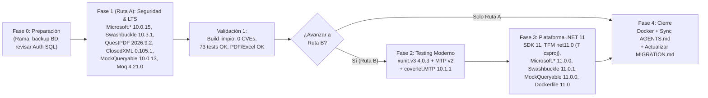

# Bitácora y Análisis de Migración Tecnológica — SBC (DataFlowHub API)

> Documento vivo y versionado cronológicamente para auditar frameworks, SDKs, contenedores, herramientas CLI y paquetes NuGet de la solución `SBC.sln`, evaluar vulnerabilidades, deprecaciones y *breaking changes*, y planificar cada ciclo de actualización antes de ejecutarlo.

---

## Convención de Versionado y Uso de Este Documento

1. **Orden cronológico inverso:** Cada nuevo ciclo de auditoría/actualización se agrega en la parte superior, justo debajo del **Índice de Ciclos**, con encabezado `## [YYYY-MM-DD] — <Título del ciclo>`.
2. **Estados permitidos:**
   - `Planificado (Solo análisis)` — Auditoría completada; aún no se han aplicado cambios en el código.
   - `En Progreso` — Migración en ejecución en una rama dedicada.
   - `Completado` — Actualización aplicada, verificada (compilación, pruebas, Docker y auditoría NuGet limpia) y reflejada en `AGENTS.md`.
   - `Descartado / Reemplazado` — Ciclo superado por una revisión posterior antes de ejecutarse.
3. **Trazabilidad:** Cada entrada registra el *commit* base analizado, el entorno verificado (`dotnet --info` y herramientas CLI) y la fecha real de consulta al registro NuGet.
4. **Reutilización:** Al final del archivo se incluye una [plantilla reutilizable](#plantilla-para-próximos-ciclos-de-actualización) para estandarizar futuros ciclos.

---

## Índice de Ciclos de Actualización

| Fecha / Versión | Alcance del Ciclo | Commit Base | Ruta Elegida | Estado |
| :--- | :--- | :--- | :--- | :--- |
| **[2026-11-20](#2026-11-20--auditoría-integral-net-1005--net-10015-lts--net-1100-sts)** | `.NET 10.0.5` → `.NET 10.0.15 LTS` (Ruta A) / `.NET 11.0.0 STS` + `xunit.v3` + `Swashbuckle 11` (Ruta B) | `5153ac5` | Pendiente de definición | `Planificado (Solo análisis)` |

---

## [2026-11-20] — Auditoría Integral: `.NET 10.0.5` → `.NET 10.0.15 LTS` / `.NET 11.0.0 STS`

### 1. Metadatos del Ciclo

| Campo | Valor |
| :--- | :--- |
| **Fecha de auditoría** | `2026-11-20` |
| **Estado** | `Planificado (Solo análisis)` *(no se ha ejecutado ninguna modificación de código ni de paquetes)* |
| **Commit base analizado** | `5153ac5` (*Add technical debt backlog documentation and guidelines*) |
| **Fuentes verificadas** | NuGet v3 (`https://api.nuget.org/v3/index.json`), `dotnet list SBC.sln package` (`--outdated`, `--highest-minor`, `--vulnerable`, `--deprecated`, `--include-transitive`), manifiestos `.nuspec`, `dotnet --info`, `dotnet tool list -g` y código fuente de los 7 proyectos |
| **Entorno local detectado** | Windows x64 · SDKs `.NET`: `8.0.428`, `9.0.321`, `10.0.115`, **`10.0.401`** (activo) · Runtime host: `10.0.15` · SDK `.NET 11`: **no instalado** · Herramienta global `dotnet-ef`: **`9.0.11`** |

---

### 2. Resumen Ejecutivo y Hallazgos Críticos

El análisis completo de los 7 proyectos de [SBC.sln](../SBC.sln) (15 referencias NuGet directas y todo el grafo transitivo) identificó cuatro puntos prioritarios:

1. **Tres vulnerabilidades de seguridad activas (2 High, 1 Moderate)** en dependencias transitivas:
   - `Microsoft.OpenApi 2.4.1` (**High**, `GHSA-v5pm-xwqc-g5wc`) arrastrado por `Swashbuckle.AspNetCore 10.1.7`.
   - `System.Security.Cryptography.Pkcs 9.0.4` (**High** `GHSA-846f-f764-76mx` y **Moderate** `GHSA-2fmv-rv2c-59x7`) arrastrado por `Microsoft.EntityFrameworkCore.SqlServer 10.0.5` → `Microsoft.Data.SqlClient 6.1.1`.
2. **Desalineación con un paquete *preview* retirado (`NU1603`):**
   - [SBC.Application.csproj](../SBC.Application/SBC.Application.csproj) solicita `Microsoft.EntityFrameworkCore 10.0.0-preview.2.25115.7`, versión que ya no existe en NuGet y fuerza resolución con advertencia `NU1603` hacia `10.0.0-preview.2.25163.8`, mientras `SBC.Api` y `SBC.Infrastructure` usan `10.0.5`.
3. **Paquetes marcados como *Deprecated* en NuGet:**
   - **Directo:** `xunit 2.9.3` (`Legacy` → reemplazado oficialmente por **`xunit.v3`**).
   - **Transitivos:** `Microsoft.OpenApi 2.4.1` (`CriticalBugs`, alternativa `>= 2.7.5`), `Microsoft.Identity.Client 4.73.1` (`CriticalBugs`) y `Azure.Identity 1.14.2` (`Other`).
4. **Decisión estratégica entre `.NET 10 (LTS)` y `.NET 11 (STS)`:**
   - **.NET 11 (`net11.0`, STS)** fue lanzado en disponibilidad general (GA) el **10 de noviembre de 2026** junto con **C# 15**, **ASP.NET Core 11** y **EF Core 11**.
   - Bajo la política de ciclo de vida de Microsoft (LTS = 3 años, STS = 2 años), **`.NET 10 (LTS)` y `.NET 11 (STS)` comparten exactamente la misma fecha de fin de soporte: `2028-11-14`**.
   - Los paquetes `Microsoft.* 11.0.0` (EF Core, Identity, JwtBearer) y `MockQueryable.Moq 11.0.0` **compilan exclusivamente para `net11.0`**; no pueden instalarse manteniendo `TargetFramework` en `net10.0`.

> [!TIP]
> **Dos rutas documentadas:** Para dar flexibilidad al equipo, este análisis detalla dos caminos completos y verificados:
> - **Ruta A — Estabilización y Seguridad en `.NET 10.0.15 LTS`:** Cierra el 100 % de los CVEs, elimina el warning `NU1603` y limpia las deprecaciones transitivas sin cambiar de `TargetFramework` ni reinstalar SDK/Docker.
> - **Ruta B — Modernización Total a `.NET 11.0.0 STS` + `xunit.v3` + `Swashbuckle 11`:** Adopta las versiones más recientes de todo el stack (`.NET 11`, C# 15, EF Core 11, `Microsoft.Data.SqlClient 7.x` sin dependencias de Azure, `Swashbuckle 11` sobre `Microsoft.OpenApi 3.x`, `xunit.v3 4.x`).
>
> Ambas rutas pueden ejecutarse de forma **secuencial** (primero Ruta A para remediar seguridad con riesgo mínimo, luego Ruta B en un PR dedicado) o **directa** (ir directamente a Ruta B).

---

### 3. Alertas de Seguridad (CVEs/GHSAs), Warnings y Deprecaciones

#### 3.1 Vulnerabilidades Activas (`dotnet list package --vulnerable --include-transitive`)

| Paquete Transitivo | Versión Actual | Severidad | Advisory / CVE | Proyectos Afectados | Origen en el Grafo | Descripción Técnica | Resolución Ruta A | Resolución Ruta B |
| :--- | :--- | :--- | :--- | :--- | :--- | :--- | :--- | :--- |
| `Microsoft.OpenApi` | `2.4.1` | **High** (CVSS 7.5) | [`GHSA-v5pm-xwqc-g5wc`](https://github.com/advisories/GHSA-v5pm-xwqc-g5wc) | `SBC.Api`, `SBC.UnitTest` | `Swashbuckle.AspNetCore 10.1.7` | DoS por *stack overflow* al parsear documentos OpenAPI con referencias circulares de esquema en JSON/YAML. | `Swashbuckle.AspNetCore 10.3.1` → `Microsoft.OpenApi 2.7.5` *(o `11.0.1` → `3.11.0`)* | `Swashbuckle.AspNetCore 11.0.1` → `Microsoft.OpenApi 3.11.0` |
| `System.Security.Cryptography.Pkcs` | `9.0.4` | **High** (CVSS 7.5) | [`GHSA-846f-f764-76mx`](https://github.com/advisories/GHSA-846f-f764-76mx) (`CVE-2026-84008`) | `SBC.Api`, `SBC.Infrastructure`, `SBC.UnitTest` | `EF.SqlServer 10.0.5` → `Microsoft.Data.SqlClient 6.1.1` | DoS por consumo cuadrático de CPU no autenticado en `SignedCms.CheckSignature` al reparsear datos X.509 maliciosos. | `EF.SqlServer 10.0.15` → `Pkcs 10.0.13` (0 CVEs) | `EF.SqlServer 11.0.0` → `Pkcs 10.0.13` (0 CVEs) |
| `System.Security.Cryptography.Pkcs` | `9.0.4` | **Moderate** (CVSS 5.9) | [`GHSA-2fmv-rv2c-59x7`](https://github.com/advisories/GHSA-2fmv-rv2c-59x7) (`CVE-2026-70162`) | `SBC.Api`, `SBC.Infrastructure`, `SBC.UnitTest` | `EF.SqlServer 10.0.5` → `Microsoft.Data.SqlClient 6.1.1` | Consumo asimétrico/cuadrático de CPU en Windows dentro de `EnvelopedCms.Decode` al procesar atributos CMS/PKCS#7. | `EF.SqlServer 10.0.15` → `Pkcs 10.0.13` (0 CVEs) | `EF.SqlServer 11.0.0` → `Pkcs 10.0.13` (0 CVEs) |

#### 3.2 Warnings de Restauración Activos

| Código | Proyecto | Detalle | Solución |
| :--- | :--- | :--- | :--- |
| `NU1603` | `SBC.Application` | `Microsoft.EntityFrameworkCore (>= 10.0.0-preview.2.25115.7)` no existe en NuGet; resuelve automáticamente a `10.0.0-preview.2.25163.8` (y arrastra `Microsoft.Extensions.Caching.Memory 10.0.0-preview.2.25163.2`). | Alinear a versión estable `10.0.15` (Ruta A) o `11.0.0` (Ruta B). |
| `NU1903` | `SBC.Api`, `SBC.UnitTest` | Alerta de auditoría NuGet por `Microsoft.OpenApi 2.4.1` (`GHSA-v5pm-xwqc-g5wc`). | Actualizar `Swashbuckle.AspNetCore` a `10.3.1` o `11.0.1`. |

#### 3.3 Paquetes en Desuso (`dotnet list package --deprecated --include-transitive`)

| Paquete | Tipo | Versión Actual | Motivo NuGet | Alternativa Oficial | Resolución Ruta A | Resolución Ruta B |
| :--- | :--- | :--- | :--- | :--- | :--- | :--- |
| `xunit` *(y `xunit.assert`, `xunit.core`, `xunit.extensibility.*`)* | Directo / Transitivo | `2.9.3` | `Legacy` | `xunit.v3` (`4.0.3`) | Opcional: mantener `2.9.3` (estable) o migrar ya a `xunit.v3 4.0.3` | Migrar a **`xunit.v3 4.0.3`** |
| `Microsoft.OpenApi` | Transitivo | `2.4.1` | `CriticalBugs` | `>= 2.7.5` | Sube a `2.7.5` (no deprecado) vía `Swashbuckle 10.3.1` | Sube a `3.11.0` (no deprecado) vía `Swashbuckle 11.0.1` |
| `Microsoft.Identity.Client` | Transitivo | `4.73.1` | `CriticalBugs` | Versiones parcheadas (`>= 4.84.2`) | Sube a `4.84.2` (no deprecado) vía `SqlClient 6.1.7` | **Eliminado** del grafo por `SqlClient 7.1.1` |
| `Azure.Identity` | Transitivo | `1.14.2` | `Other` | Versiones parcheadas (`>= 1.17.1`) | Sube a `1.17.1` (no deprecado) vía `SqlClient 6.1.7` | **Eliminado** del grafo por `SqlClient 7.1.1` |

---

### 4. Inventario Completo de Tecnologías, Frameworks y Paquetes

#### 4.1 Plataforma, SDK, Docker y Herramientas CLI

| Componente | Archivo / Ubicación | Versión Actual | Objetivo Ruta A (LTS) | Objetivo Ruta B (Latest) | Notas / Requisitos |
| :--- | :--- | :--- | :--- | :--- | :--- |
| **TargetFramework** | Los 7 archivos `.csproj` | `net10.0` | `net10.0` | **`net11.0`** | Ambas tienen EOL `2028-11-14`. Ruta B requiere cambiar `<TargetFramework>` en los 7 proyectos. |
| **Versión de C#** | Implícita por TFM | C# 14 | C# 14 | **C# 15** | C# 15 agrega `union` (keyword contextual) y argumentos en *collection expressions*. |
| **.NET SDK (desarrollo / CI)** | Entorno local / CI | `10.0.401` | `10.0.401` *(sin cambios)* | **`11.0.x`** *(requiere instalación)* | Instalar .NET 11 SDK en máquinas de desarrollo y pipelines antes de iniciar Ruta B. |
| **Imágenes base Docker** | [SBC.Api/Dockerfile](../SBC.Api/Dockerfile) | `aspnet:10.0` / `sdk:10.0` | `aspnet:10.0` / `sdk:10.0` | **`aspnet:11.0` / `sdk:11.0`** | También revisar la etapa `restore` del Dockerfile (actualmente solo copia `SBC.Api.csproj` antes de `dotnet restore`, ver §6.6). |
| **CLI `dotnet-ef`** | Herramienta global (`dotnet tool list -g`) | `9.0.11` | **`10.0.15`** | **`11.0.0`** | Desfasada dos versiones respecto a EF 11; actualizar con `dotnet tool update --global dotnet-ef --version <ver>`. Considerar manifiesto local `.config/dotnet-tools.json`. |
| **Solución** | [SBC.sln](../SBC.sln) | Formato `.sln` v12.00 | Sin cambios | Sin cambios *(opcional: `.slnx`)* | Compatible con SDK 10 y SDK 11. |

#### 4.2 Matriz Maestra de Paquetes NuGet Directos (15 referencias en 7 proyectos)

*(Los proyectos [SBC.Domain](../SBC.Domain/SBC.Domain.csproj) y [SBC.Application.Models](../SBC.Application.Models/SBC.Application.Models.csproj) no tienen `PackageReference` directos.)*

| Proyecto | Paquete | Solicitado | Resuelto | Objetivo Ruta A (`net10.0`) | Objetivo Ruta B (`net11.0`) | Restricción TFM (Verificada en `.nuspec`) | Salto (Ruta B) | Riesgo |
| :--- | :--- | :--- | :--- | :--- | :--- | :--- | :--- | :--- |
| **SBC.Api** | `Microsoft.EntityFrameworkCore.Design` | `10.0.5` | `10.0.5` | `10.0.15` | `11.0.0` | `11.0.0` exige `net11.0` | Major | Medio |
| **SBC.Api** | `Swashbuckle.AspNetCore` | `10.1.7` | `10.1.7` | `10.3.1` *(o `11.0.1`)* | `11.0.1` | `11.0.1` soporta `net10.0` y `net11.0` | Major | Bajo-Medio |
| **SBC.Application** | `ClosedXML` | `0.105.0` | `0.105.0` | `0.105.1` | `0.105.1` | `netstandard2.0` / `netstandard2.1` | Patch | Muy bajo |
| **SBC.Application** | `Microsoft.AspNetCore.Authentication.JwtBearer` | `10.0.5` | `10.0.5` | `10.0.15` | `11.0.0` | `11.0.0` exige `net11.0` | Major | Bajo |
| **SBC.Application** | `Microsoft.EntityFrameworkCore` | `10.0.0-preview.2.25115.7` | `10.0.0-preview.2.25163.8` | `10.0.15` | `11.0.0` | `11.0.0` exige `net11.0` | Preview → Major | Medio |
| **SBC.Application** | `QuestPDF` | `2026.2.4` | `2026.2.4` | `2026.9.2` | `2026.9.2` | `net10.0`, `net8.0`, `net6.0`, `net5.0`, `netstandard2.0` | Minor (Breaking) | **Alto** |
| **SBC.Domain.Entities** | `Microsoft.Extensions.Identity.Stores` | `10.0.5` | `10.0.5` | `10.0.15` | `11.0.0` | `net11.0`, `netstandard2.0`, `net462` | Major | Bajo |
| **SBC.Infrastructure** | `Microsoft.AspNetCore.Identity.EntityFrameworkCore` | `10.0.5` | `10.0.5` | `10.0.15` | `11.0.0` | `11.0.0` exige `net11.0` | Major | Bajo |
| **SBC.Infrastructure** | `Microsoft.EntityFrameworkCore.SqlServer` | `10.0.5` | `10.0.5` | `10.0.15` | `11.0.0` | `11.0.0` exige `net11.0` | Major | Medio |
| **SBC.UnitTest** | `coverlet.collector` | `8.0.1` | `8.0.1` | `10.1.1` | `10.1.1` *(VSTest)* ó **`coverlet.MTP 10.1.1`** *(MTP)* | Independiente de TFM (`coverlet.MTP`: `net8.0`/`net10.0`) | Major / Reemplazo | **Alto** (con MTP) |
| **SBC.UnitTest** | `Microsoft.NET.Test.Sdk` | `18.3.0` | `18.3.0` | `18.12.0` | `18.12.0` *(VSTest)* ó **Eliminar** *(MTP puro)* | `net8.0`, `net462` | Minor / Opcional | Bajo |
| **SBC.UnitTest** | `MockQueryable.Moq` | `7.0.3` | `7.0.3` | `10.0.13` | `11.0.0` | `10.0.13` exige `net10.0`; `11.0.0` exige `net11.0` | Major (7→11) | Medio |
| **SBC.UnitTest** | `Moq` | `4.20.72` | `4.20.72` | `4.21.0` | `4.21.0` | `net6.0`, `netstandard2.0/2.1`, `net462` | Minor | Bajo |
| **SBC.UnitTest** | `xunit` | `2.9.3` *(Deprecated)* | `2.9.3` | `2.9.3` *(o migrar a `xunit.v3 4.0.3`)* | **`xunit.v3 4.0.3`** | `net8.0+`, `net472+` | Reemplazo Major | **Alto** (tooling) / Bajo (código) |
| **SBC.UnitTest** | `xunit.runner.visualstudio` | `3.1.5` | `3.1.5` | `4.0.1` | `4.0.1` *(VSTest)* ó **Eliminar** *(MTP puro)* | `net8.0+`, `net472+` (soporta xUnit v1, v2 y v3) | Major (3→4) | Medio |

#### 4.3 Dependencias Transitivas Relevantes

| Paquete Transitivo | Resuelto Actual | Última en NuGet | Qué ocurre en Ruta A | Qué ocurre en Ruta B | Observaciones |
| :--- | :--- | :--- | :--- | :--- | :--- |
| `Microsoft.OpenApi` | `2.4.1` | `3.11.1` | Sube a `2.7.5` (`Swashbuckle 10.3.1`) o `3.11.0` (`11.0.1`) | Sube a `3.11.0` (`Swashbuckle 11.0.1`) | Elimina CVE High `GHSA-v5pm-xwqc-g5wc` y deprecación. |
| `Microsoft.Data.SqlClient` | `6.1.1` | `7.1.2` | Sube a `6.1.7` (`EF.SqlServer 10.0.15`) | Sube a `7.1.1` (`EF.SqlServer 11.0.0`) | v7 extrae auth Azure/Entra ID a paquete separado. |
| `System.Security.Cryptography.Pkcs` | `9.0.4` | `11.0.0` | Sube a `10.0.13` (`EF.SqlServer 10.0.15`) | Sube a `10.0.13` (`EF.SqlServer 11.0.0`) | Elimina CVEs `GHSA-846f-f764-76mx` y `GHSA-2fmv-rv2c-59x7`. |
| `Azure.Identity` | `1.14.2` | `1.21.0` | Sube a `1.17.1` (no deprecado) | **Eliminado** del grafo | Se vuelve opt-in vía `Microsoft.Data.SqlClient.Extensions.Azure`. |
| `Microsoft.Identity.Client` | `4.73.1` | `4.92.0` | Sube a `4.84.2` (no deprecado) | **Eliminado** del grafo | Mismo motivo que `Azure.Identity`. |
| `Microsoft.IdentityModel.*` / `System.IdentityModel.Tokens.Jwt` | `8.0.1` | `8.23.0` | Sube a `8.19.2` (`JwtBearer 10.0.15`) | Sube a `8.19.2` (`JwtBearer 11.0.0`) | Actualización compatible de la pila JWT. |
| `DocumentFormat.OpenXml` | `3.1.1` | `3.5.1` | Se mantiene `>= 3.1.1` (`ClosedXML 0.105.1`) | Se mantiene `>= 3.1.1` (`ClosedXML 0.105.1`) | Gestionado por `ClosedXML` (`[3.1.1, 4.0.0)`). |
| `SixLabors.Fonts` | `1.0.0` | `3.2.0` | Acotado a `[1.0.0, 3.0.0)` por `ClosedXML 0.105.1` | Acotado a `[1.0.0, 3.0.0)` por `ClosedXML 0.105.1` | **No** forzar `3.x` manualmente; rompería `ClosedXML`. |
| `Castle.Core` | `5.1.1` | `5.2.1` | Sube a `5.2.1` (`Moq 4.21.0`) | Sube a `5.2.1` (`Moq 4.21.0`) | Transparente. |
| `MockQueryable.EntityFrameworkCore` / `.Core` | `7.0.3` | `11.0.0` | Sube a `10.0.13` (`MockQueryable.Moq 10.0.13`) | Sube a `11.0.0` (`MockQueryable.Moq 11.0.0`) | Acoplado a la versión mayor de EF Core. |
| `xunit.analyzers` | `1.18.0` | `2.3.0` | Sin cambios (si se queda en xUnit v2) | Sube a `2.3.0` (vía `xunit.v3.mtp-v2 4.0.3`) | Puede reportar nuevas advertencias de buenas prácticas en los tests. |

---

### 5. Análisis Detallado de Breaking Changes e Impacto Real en SBC

#### 5.1 `.NET 11`, `C# 15`, `ASP.NET Core 11` e `Identity / JWT` *(Aplica solo a Ruta B)*

| Cambio / Breaking Change | Aplica a SBC | Archivos Verificados | Detalle y Acción Requerida |
| :--- | :---: | :--- | :--- |
| **Cambio obligatorio de TFM (`net10.0` → `net11.0`)** | **Sí** | Los 7 `.csproj` + [SBC.Api/Dockerfile](../SBC.Api/Dockerfile) | Los paquetes `Microsoft.* 11.0.0` solo publican ensamblados `net11.0`. Requiere instalar .NET 11 SDK y cambiar `aspnet:10.0`/`sdk:10.0` a `11.0` en Docker. |
| **ASP.NET Core Identity 11 — Igualdad ordinal en *external logins*** | No *(preventivo)* | [AuthService.cs](../SBC.Application/Services/Implementation/AuthService.cs), [UserService.cs](../SBC.Application/Services/Implementation/UserService.cs) | `FindByLoginAsync` y `RemoveLoginAsync` ahora validan `LoginProvider` y `ProviderKey` con `StringComparison.Ordinal` en memoria además de la consulta en SQL Server. SBC actualmente solo usa usuario/contraseña locales (no hay logins externos), por lo que el impacto es **nulo**; tenerlo presente si en el futuro se integra OAuth/OIDC externo. |
| **JWT Bearer & `JwtSecurityTokenHandler` vs `JsonWebTokenHandler`** | Bajo *(preventivo)* | [AuthService.cs](../SBC.Application/Services/Implementation/AuthService.cs#L178-L220), [Program.cs](../SBC.Api/Program.cs#L56-L73) | [Program.cs](../SBC.Api/Program.cs#L56-L73) no define `JwtBearerEvents` personalizados que casteen `SecurityToken`. [AuthService.cs](../SBC.Application/Services/Implementation/AuthService.cs#L178-L220) instancia explícitamente `JwtSecurityTokenHandler` y valida `securityToken is not JwtSecurityToken`, lo cual sigue siendo compatible con `Microsoft.IdentityModel 8.19.2`. Como mejora futura opcional se puede migrar a `JsonWebTokenHandler` (más rápido y asíncrono). |
| **OpenAPI 3.2 por defecto en ASP.NET Core 11** | No | [Program.cs](../SBC.Api/Program.cs#L20-L31) | Aplica a `Microsoft.AspNetCore.OpenApi` nativo; SBC usa `Swashbuckle.AspNetCore` (que mantiene OpenAPI 3.0 por defecto incluso en v11). |
| **Eliminación de middleware `ConcurrencyLimiter`** | No | [Program.cs](../SBC.Api/Program.cs) | No se utiliza en SBC. |
| **C# 15 (`union` keyword contextual)** | No | Todo el repositorio | Ningún tipo o identificador en el proyecto colisiona con nuevas palabras clave contextuales de C# 15. |

---

#### 5.2 `Entity Framework Core` (`10.0.5` / `preview` → `10.0.15` o `11.0.0`) y `Microsoft.Data.SqlClient` (`6.1.1` → `6.1.7` o `7.1.1`)

| Cambio / Breaking Change | Aplica a SBC | Archivos Verificados | Detalle y Acción Requerida |
| :--- | :---: | :--- | :--- |
| **Corrección de paquete *preview* en `SBC.Application`** | **Sí (Ruta A y B)** | [SBC.Application.csproj](../SBC.Application/SBC.Application.csproj#L17), [UserService.cs](../SBC.Application/Services/Implementation/UserService.cs#L4) | `Microsoft.EntityFrameworkCore` solo se usa en [UserService.cs](../SBC.Application/Services/Implementation/UserService.cs#L171-L195) para `CountAsync()` y `ToListAsync()` sobre `userManager.Users`. Alinear su versión exacta con `SBC.Infrastructure` y `SBC.Api` (`10.0.15` o `11.0.0`) elimina el warning `NU1603` y quita `Microsoft.Extensions.Caching.Memory 10.0.0-preview.2.25163.2`. |
| **`Microsoft.Data.SqlClient 7.0+` — Extracción de autenticación Azure/Entra ID** *(Ruta B)* | **Condicional** | [SBC.Infrastructure.csproj](../SBC.Infrastructure/SBC.Infrastructure.csproj), cadena `DefaultConnection` | `EF.SqlServer 11.0.0` actualiza `Microsoft.Data.SqlClient` de `6.1.1` a **`7.1.1`**, eliminando `Azure.Identity`, `Azure.Core`, `Microsoft.Identity.Client` y `Microsoft.Identity.Client.Extensions.Msal` del paquete base.<br>• **Si `DefaultConnection` usa SQL Auth o Windows Integrated Auth:** Sin cambios de código; reduce el tamaño de publicación y elimina 2 paquetes transitivos deprecados.<br>• **Si `DefaultConnection` usa `Authentication=Active Directory ...` (Entra ID):** Lanzará error en tiempo de ejecución pidiendo agregar explícitamente `<PackageReference Include="Microsoft.Data.SqlClient.Extensions.Azure" Version="1.x" />` en `SBC.Infrastructure`. |
| **EF Core 11 — Validación estricta de entidades *owned* compartidas** *(Ruta B)* | No | [SbcDbContext.cs](../SBC.Infrastructure/Database/SbcDbContext.cs), `Database/Configurations/*` | No existen llamadas a `OwnsOne` ni `OwnsMany` en las configuraciones del modelo. |
| **EF Core 11 — `SqlVector<T>` nulo por defecto / Cosmos DB / SQLite** *(Ruta B)* | No | [SBC.Infrastructure.csproj](../SBC.Infrastructure/SBC.Infrastructure.csproj) | SBC usa exclusivamente SQL Server relacional sin columnas vectoriales. |
| **Beneficio en EF Core 11 — *Automatic Join Pruning* en `SplitQuery`** *(Ruta B)* | **Sí (Positivo)** | [Program.cs](../SBC.Api/Program.cs#L38) | SBC ya configura `QuerySplittingBehavior.SplitQuery` globalmente; EF Core 11 optimiza automáticamente joins redundantes en consultas divididas. |
| **Herramienta `dotnet-ef` y verificación de migraciones** | **Sí (Ruta A y B)** | `SBC.Infrastructure/Migrations/*` | Actualizar `dotnet-ef` de `9.0.11` a `10.0.15` (Ruta A) o `11.0.0` (Ruta B). Después de subir EF Core, ejecutar `dotnet ef migrations has-pending-model-changes --project SBC.Infrastructure --startup-project SBC.Api` para verificar que el cambio de versión no alteró anotaciones del `SbcDbContextModelSnapshot` (en EF 11 también se puede adoptar `net-ef.json` para evitar repetir `--project` / `--startup-project`). |

---

#### 5.3 `Swashbuckle.AspNetCore` (`10.1.7` → `10.3.1` o `11.0.1`) y `Microsoft.OpenApi` (`2.4.1` → `2.7.5` o `3.11.0`)

| Aspecto | Opción Ruta A Conservadora (`10.3.1`) | Opción Moderna (`11.0.1` — válida en Ruta A y obligatoria en Ruta B) |
| :--- | :--- | :--- |
| **`Microsoft.OpenApi` resuelto** | `2.7.5` | `3.11.0` |
| **Resuelve CVE High `GHSA-v5pm-xwqc-g5wc`** | **Sí** | **Sí** |
| **Soporte TFM** | `net8.0`, `net9.0`, `net10.0` | `net10.0`, `net11.0` |
| **Breaking changes de API** | **Ninguno** | Migración interna a `Microsoft.OpenApi` v3 (`IOpenApiMediaType`, eliminación de `OpenApiAny`/`OpenApiString` en favor de `JsonNode`, Redoc 3). |
| **Impacto real en código de SBC** | **Nulo** | **Nulo en compilación.** Verificado en [Program.cs](../SBC.Api/Program.cs#L7) y [Program.cs](../SBC.Api/Program.cs#L20-L31): SBC únicamente usa `new OpenApiInfo`, `IncludeXmlComments`, `UseSwagger()` y `UseSwaggerUI()`. No existen `ISchemaFilter`, `IOperationFilter` ni `IDocumentFilter`. |
| **Verificación requerida** | Abrir `/swagger/v1/swagger.json` y Swagger UI. | Abrir `/swagger/v1/swagger.json` y Swagger UI, y comparar el esquema generado (sigue emitiendo OpenAPI 3.0 por defecto salvo que se habilite OpenAPI 3.1/3.2). Si en el futuro se agrega configuración de seguridad Bearer en Swagger, deberá escribirse con la API de `Microsoft.OpenApi` v3. |

---

#### 5.4 `QuestPDF` (`2026.2.4` → `2026.9.2`) — **Alto Impacto / Breaking Changes** *(Aplica a Ruta A y Ruta B)*

Es el paquete de aplicación con los cambios de comportamiento más sensibles respecto a la versión actual (`2026.2.4`):

1. **Fuentes del sistema deshabilitadas por defecto:**
   - `Settings.UseEnvironmentFonts` fue renombrado a **`Settings.UseSystemFonts`** y su valor por defecto cambió a **`false`**.
   - QuestPDF usa ahora exclusivamente su fuente embebida **Lato**, archivos en el directorio de la aplicación, `Settings.FontDiscoveryPath` o fuentes registradas explícitamente con `FontManager`.
2. **Validación estricta de familias de fuentes y glifos:**
   - **`Settings.ThrowOnMissingFontFamilies`** pasa a ser **`true`** por defecto: cualquier fuente ausente detiene la generación con `DocumentDrawingException` en lugar de hacer *fallback* silencioso.
   - La validación de glifos faltantes también detiene la generación por defecto.
3. **Empaquetado comprimido de Lato y renombrado de binarios nativos:**
   - La carpeta `LatoFont` se sustituye por **`QuestPDF.Fonts.Lato.br`** (para .NET 5+), reduciendo ~40 % el tamaño del paquete.
   - Los binarios nativos se renombraron a `snake_case` (`questpdf_skia`, `questpdf_qpdf`), y el motor Skia subió a `m158`.
4. **Diagnóstico de layout:** `Settings.EnableDetailedLayoutErrors` pasa a `false` por defecto.

**Impacto verificado en SBC:**
- En [FinancialReportService.cs](../SBC.Application/Services/Implementation/FinancialReportService.cs#L18-L21) solo se establece `QuestPDF.Settings.License = LicenseType.Community;` y en [FinancialReportService.cs](../SBC.Application/Services/Implementation/FinancialReportService.cs#L191-L275) y [FinancialReportService.cs](../SBC.Application/Services/Implementation/FinancialReportService.cs#L448-L531) **no se invoca `.FontFamily(...)`** (utiliza Lato por defecto), aplicando `.SemiBold()` y textos en español con acentos (`"Página "`, `"Histórica"`).
- Aunque la fuente embebida Lato cubre caracteres latinos/español (y de hecho hace más determinista la ejecución dentro de contenedores Linux sin fuentes instaladas), **se debe verificar explícitamente**:
  1. Que `GenerateIncomeStatementPdfAsync` y `GenerateBalanceSheetPdfAsync` generen PDFs válidos con datos reales (incluyendo tildes, `ñ` y símbolos monetarios) sin lanzar `DocumentDrawingException`.
  2. Que `dotnet publish` y la imagen Docker Linux incluyan `QuestPDF.Fonts.Lato.br` y los binarios nativos `questpdf_skia`/`questpdf_qpdf` (no hay scripts custom que copien `LatoFont`, lo cual evita rupturas de despliegue).
  3. En caso de requerir compatibilidad temporal con fuentes del SO o diagnósticos detallados en desarrollo, el ajuste de referencia sería en el constructor estático de `FinancialReportService` (o al inicio de `Program.cs`):
     ```csharp
     // Referencia ilustrativa (solo si se requiere durante migración):
     QuestPDF.Settings.License = LicenseType.Community;
     // QuestPDF.Settings.UseSystemFonts = true;            // Solo si se usan fuentes del SO
     // QuestPDF.Settings.EnableDetailedLayoutErrors = true; // Útil solo en Development
     ```

---

#### 5.5 `ClosedXML` (`0.105.0` → `0.105.1`) *(Aplica a Ruta A y Ruta B)*

- **Cambio en `0.105.1`:** Acota explícitamente la dependencia transitiva `SixLabors.Fonts` al rango `[1.0.0, 3.0.0)` (evitando conflictos con `SixLabors.Fonts 3.x`).
- **Breaking changes:** **Ninguno** respecto a `0.105.0`.
- **Observaciones detectadas en el código de SBC:**
  - [FinancialReportService.cs](../SBC.Application/Services/Implementation/FinancialReportService.cs#L180) (y línea 437) y [BulkImportService.cs](../SBC.Application/Services/Implementation/BulkImportService.cs#L245) llaman a `worksheet.Columns().AdjustToContents()`. Esta llamada depende de `SixLabors.Fonts`; al probar la API en el contenedor Linux de [SBC.Api/Dockerfile](../SBC.Api/Dockerfile), conviene verificar que `AdjustToContents()` no falle por ausencia de fuentes del sistema operativo.
  - Se detectó un `using ClosedXML.Excel;` sin uso en [JournalEntryService.cs](../SBC.Application/Services/Implementation/JournalEntryService.cs#L9) (limpieza menor opcional).

---

#### 5.6 Stack de Pruebas Unitarias (`SBC.UnitTest`) — **Alto Impacto en Tooling / Runner**

##### A. Migración de `xunit 2.9.3` (Deprecated) → `xunit.v3 4.0.3` + `xunit.runner.visualstudio` + `coverlet`

**Auditoría del código actual de tests (`SBC.UnitTest`):**
Se escanearon las 14 clases de prueba (6 de controladores + 8 de servicios):
- **73 métodos `[Fact]`** y **0 `[Theory]`**.
- **0** usos de `ITestOutputHelper`, `IAsyncLifetime`, `IClassFixture`, `ICollectionFixture`, `Xunit.Abstractions`, atributos personalizados o `async void`.
- Todas las aserciones son estándar (`Assert.Equal`, `Assert.True`, `Assert.False`, `Assert.IsType`, `Assert.NotNull`, `Assert.Null`, `Assert.NotEmpty`, `Assert.NotEqual`, `Assert.Single`, `Assert.Contains`, `Assert.All`, `Assert.ThrowsAsync`).

**Conclusión clave:** El código C# de las 73 pruebas tiene **impacto prácticamente nulo** al migrar a `xunit.v3 4.0.3` (solo podrían aparecer advertencias menores del nuevo `xunit.analyzers 2.3.0`). **El verdadero *breaking change* está en la arquitectura de ejecución y cobertura de [SBC.UnitTest.csproj](../SBC.UnitTest/SBC.UnitTest.csproj):**

- `xunit.v3 4.0.3` instala `xunit.v3.mtp-v2 4.0.3` (Microsoft Testing Platform **v2**; soporte para MTP v1 eliminado en v4.0) y convierte el proyecto de pruebas en un ejecutable (`<OutputType>Exe</OutputType>`).
- **`coverlet.collector` (`10.1.1`) es arquitectónicamente incompatible con el modo MTP puro** porque depende del *data collector* legado de VSTest. Además, `coverlet.collector 10.x` cambió su heurística de exclusión por defecto (ahora solo excluye ensamblados con cero archivos fuente encontrados; el comportamiento anterior se recupera con `<ExcludeAssembliesWithoutSources>MissingAny</ExcludeAssembliesWithoutSources>`).

Existen **dos arquitecturas válidas** para el proyecto de pruebas al adoptar `xunit.v3 4.0.3`:

| Criterio | Opción 1: **MTP v2 Nativo** *(Recomendada para Ruta B / largo plazo)* | Opción 2: **Puente VSTest** *(Transición conservadora / Ruta A)* |
| :--- | :--- | :--- |
| **Paquetes en `SBC.UnitTest.csproj`** | • `xunit.v3` (`4.0.3`)<br>• **`coverlet.MTP` (`10.1.1`)** *(o `Microsoft.Testing.Extensions.CodeCoverage 18.12.0`)*<br>• **Eliminar** `xunit`, `Microsoft.NET.Test.Sdk`, `xunit.runner.visualstudio` y `coverlet.collector` | • `xunit.v3` (`4.0.3`) *(o mantener `xunit 2.9.3` temporalmente en Ruta A)*<br>• `Microsoft.NET.Test.Sdk` (`18.12.0`)<br>• `xunit.runner.visualstudio` (`4.0.1`, soporta v1/v2/v3)<br>• `coverlet.collector` (`10.1.1`) |
| **Propiedades MSBuild / `global.json`** | `<OutputType>Exe</OutputType>` en `SBC.UnitTest.csproj` y configurar `global.json` en la raíz con `"test": { "runner": "Microsoft.Testing.Platform" }` para ejecutar `dotnet test` nativamente en SDK .NET 10/11. | `<OutputType>Exe</OutputType>` (si usa `xunit.v3`) + `<TestingPlatformDotnetTestSupport>false</TestingPlatformDotnetTestSupport>` si el SDK intenta forzar MTP y rompe `coverlet.collector`. |
| **Comando de ejecución** | `dotnet test` (con `global.json`) o `dotnet run --project SBC.UnitTest` | `dotnet test SBC.UnitTest/SBC.UnitTest.csproj` (idéntico al actual) |
| **Cobertura de código** | Nativa en MTP vía `--coverage` (`coverlet.MTP` / `Microsoft.Testing.Extensions.CodeCoverage`) | `--collect:"XPlat Code Coverage"` (`coverlet.collector`) |
| **Riesgo de cambio en CI / IDE** | Medio (actualizar flags de `dotnet test` / cobertura y validar Test Explorer en Visual Studio/Rider) | Bajo (preserva los comandos exactos actuales) |

*Fragmento ilustrativo para Opción 1 (MTP v2 nativo en `net11.0`, **no aplicado**):*
```xml
<!-- SBC.UnitTest/SBC.UnitTest.csproj (referencia para Ruta B / MTP v2) -->
<PropertyGroup>
    <TargetFramework>net11.0</TargetFramework>
    <OutputType>Exe</OutputType>
    <ImplicitUsings>enable</ImplicitUsings>
    <Nullable>enable</Nullable>
    <IsPackable>false</IsPackable>
</PropertyGroup>
<ItemGroup>
    <PackageReference Include="coverlet.MTP" Version="10.1.1" />
    <PackageReference Include="MockQueryable.Moq" Version="11.0.0" />
    <PackageReference Include="Moq" Version="4.21.0" />
    <PackageReference Include="xunit.v3" Version="4.0.3" />
</ItemGroup>
```

```json
// global.json (raíz del repositorio, requerido por dotnet test con MTP en SDK 10/11)
{
  "test": {
    "runner": "Microsoft.Testing.Platform"
  }
}
```

##### B. `MockQueryable.Moq` (`7.0.3` → `10.0.13` en Ruta A / `11.0.0` en Ruta B)

- **Acoplamiento estricto por TFM y EF Core:** Verificado en `.nuspec`: `MockQueryable.Moq 10.0.13` solo soporta `net10.0` (requiere EF Core 10) y `MockQueryable.Moq 11.0.0` solo soporta `net11.0` (requiere EF Core 11). Ambos arrastran transitivamente `MockQueryable.EntityFrameworkCore` (misma versión) y `Moq 4.21.0`.
- **Impacto directo en [UserServiceTests.cs](../SBC.UnitTest/Services/UserServiceTests.cs#L3-L4) y líneas 154 y 180:**
  - Actualmente el código hace:
    ```csharp
    using MockQueryable;
    using MockQueryable.Moq;
    ...
    var mock = userList.AsQueryable().BuildMock();
    ```
  - En las versiones `8.x`–`11.x`, `BuildMock()` se desacopló hacia `MockQueryable.EntityFrameworkCore` y la práctica recomendada es invocar `BuildMock()` **directamente sobre `IEnumerable<T>`** para evitar problemas de proveedor asíncrono (`IAsyncQueryProvider`) al envolver con `.AsQueryable()`:
    ```csharp
    var mock = userList.BuildMock();
    ```
  - *(Nota: si el proyecto no usa `BuildMockDbSet()`, bastaría incluso con `MockQueryable.EntityFrameworkCore`, o mantener `MockQueryable.Moq` por consistencia con la documentación de pruebas del proyecto.)*

##### C. `Moq` (`4.20.72` → `4.21.0`)

- **Cambios principales:** Sin *breaking changes* de API documentados; optimiza `It.Is`, mejora manejo de `ValueTask`, sube `Castle.Core` a `5.2.1` y habilita *Nullable Reference Types* (NRT) en el propio paquete `Moq`.
- **Punto de verificación en SBC:** Confirmar que no surjan advertencias de nulabilidad en los constructores mock de `UserManager<ApplicationUser>` con `null!` en [UserServiceTests.cs](../SBC.UnitTest/Services/UserServiceTests.cs#L24) y [AuthServiceTests.cs](../SBC.UnitTest/Services/AuthServiceTests.cs#L23).

---

### 6. Comparativa Detallada y Plan de Ejecución por Fases

#### 6.1 Comparativa Directa: Ruta A vs. Ruta B

| Dimensión | Ruta A — `.NET 10.0.15 LTS` | Ruta B — `.NET 11.0.0 STS` + Modernización Total |
| :--- | :--- | :--- |
| **TargetFramework / Lenguaje** | `net10.0` / C# 14 | `net11.0` / C# 15 |
| **Fin de soporte Microsoft** | `2028-11-14` | `2028-11-14` |
| **¿Requiere instalar nuevo SDK?** | No (`10.0.401` ya instalado) | **Sí** (instalar `.NET 11 SDK`) |
| **¿Requiere actualizar Dockerfile?** | No (`10.0` vigente) | **Sí** (`aspnet:11.0` y `sdk:11.0`) |
| **Resuelve los 3 CVEs (`GHSA-*`)** | **Sí (100 %)** | **Sí (100 %)** |
| **Elimina warning `NU1603` (preview EF)** | **Sí** | **Sí** |
| **Elimina deprecaciones transitivas (`OpenApi`, `Azure.Identity`, `MSAL`)** | **Sí** (actualizándolos a versiones parcheadas) | **Sí** (y además elimina `Azure.Identity` y `MSAL` del grafo vía `SqlClient 7`) |
| **Elimina deprecación directa de `xunit 2.9.3`** | Opcional (puede diferirse o incluirse) | **Sí** (`xunit.v3 4.0.3` + MTP v2) |
| **Incluye breaking changes de `QuestPDF 2026.9.2`** | **Sí** | **Sí** |
| **Incluye breaking changes de `SqlClient 7.x` (Entra ID) y `OpenApi 3.x`** | No *(si usa `Swashbuckle 10.3.1`)* | **Sí** (`SqlClient 7.1.1` y `Swashbuckle 11.0.1`) |
| **Esfuerzo / Riesgo estimado** | **Bajo-Medio** (~2–4 h incluyendo pruebas PDF/Excel) | **Medio-Alto** (~1–2 días incluyendo SDK, CI/Docker, MTP y pruebas integrales) |

#### 6.2 Diagrama de Orden de Ejecución Recomendado



#### 6.3 Detalle de Fases de Ejecución

##### Fase 0 — Preparación (Previo a cualquier ruta)
1. Crear una rama dedicada (ej. `chore/upgrade-dependencies-2026-11`).
2. Verificar el método de autenticación de `ConnectionStrings:DefaultConnection` en todos los ambientes (Dev, QA, Prod): confirmar si usa SQL Auth / Windows Auth o **Azure Entra ID** (crítico para `Microsoft.Data.SqlClient 7.x` en Ruta B).
3. Realizar respaldo de la base de datos de desarrollo/pruebas antes de validar migraciones EF Core.
4. **Mejora estructural recomendada (opcional):** Adoptar *Central Package Management* creando `Directory.Packages.props` en la raíz del repositorio (`<ManagePackageVersionsCentrally>true</ManagePackageVersionsCentrally>`) para que todas las versiones NuGet se gestionen desde un único punto y nunca vuelva a ocurrir un desfase como el de `SBC.Application` (`preview` vs `10.0.5`).

##### Fase 1 — Ejecución Ruta A (Estabilización y Seguridad en `.NET 10.0.15 LTS`)
1. Actualizar `dotnet-ef` global: `dotnet tool update --global dotnet-ef --version 10.0.15`.
2. Actualizar paquetes en los `.csproj` manteniendo `<TargetFramework>net10.0</TargetFramework>`:
   - `SBC.Api`: `Microsoft.EntityFrameworkCore.Design` → `10.0.15`; `Swashbuckle.AspNetCore` → `10.3.1` *(o `11.0.1` si se desea adelantar `OpenApi 3.x`)*.
   - `SBC.Application`: `Microsoft.EntityFrameworkCore` → `10.0.15` *(elimina `NU1603`)*; `Microsoft.AspNetCore.Authentication.JwtBearer` → `10.0.15`; `ClosedXML` → `0.105.1`; `QuestPDF` → `2026.9.2`.
   - `SBC.Domain.Entities`: `Microsoft.Extensions.Identity.Stores` → `10.0.15`.
   - `SBC.Infrastructure`: `Microsoft.EntityFrameworkCore.SqlServer` → `10.0.15`; `Microsoft.AspNetCore.Identity.EntityFrameworkCore` → `10.0.15`.
   - `SBC.UnitTest`: `MockQueryable.Moq` → `10.0.13`; `Moq` → `4.21.0`; `Microsoft.NET.Test.Sdk` → `18.12.0`; `coverlet.collector` → `10.1.1`; `xunit.runner.visualstudio` → `4.0.1`.
3. En [UserServiceTests.cs](../SBC.UnitTest/Services/UserServiceTests.cs#L154) y línea 180, ajustar `userList.AsQueryable().BuildMock()` a `userList.BuildMock()`.
4. Ejecutar compilación, pruebas unitarias y validación manual de PDFs (QuestPDF `2026.9.2`), Excel (ClosedXML) y Swagger.

##### Fase 2 — Modernización de Testing a `xunit.v3 4.0.3` *(Parte de Ruta B; opcional en Ruta A)*
1. Elegir estrategia de runner:
   - **Opción 1 (MTP v2 puro — recomendada):** agregar `<OutputType>Exe</OutputType>` a `SBC.UnitTest.csproj`, reemplazar `xunit` por `xunit.v3 4.0.3`, reemplazar `coverlet.collector` por `coverlet.MTP 10.1.1`, remover `Microsoft.NET.Test.Sdk` y `xunit.runner.visualstudio`, y crear `global.json` con `"test": { "runner": "Microsoft.Testing.Platform" }`.
   - **Opción 2 (Puente VSTest):** agregar `<OutputType>Exe</OutputType>`, reemplazar `xunit` por `xunit.v3 4.0.3`, mantener `Microsoft.NET.Test.Sdk 18.12.0`, `xunit.runner.visualstudio 4.0.1` y `coverlet.collector 10.1.1`, y configurar `<TestingPlatformDotnetTestSupport>false</TestingPlatformDotnetTestSupport>` si el SDK fuerza MTP.
2. Resolver cualquier advertencia nueva emitida por `xunit.analyzers 2.3.0`.
3. Verificar ejecución de las 73 pruebas y generación de reporte de cobertura.

##### Fase 3 — Actualización de Plataforma a `.NET 11.0.0 STS` *(Ruta B)*
1. Instalar **.NET 11 SDK** en máquinas de desarrollo y runners de CI/CD.
2. Actualizar `dotnet-ef` global a `11.0.0`: `dotnet tool update --global dotnet-ef --version 11.0.0`.
3. Cambiar `<TargetFramework>net10.0</TargetFramework>` a `<TargetFramework>net11.0</TargetFramework>` en los **7 archivos `.csproj`**.
4. Actualizar paquetes a la línea `11.x`:
   - `SBC.Api`: `Microsoft.EntityFrameworkCore.Design` → `11.0.0`; `Swashbuckle.AspNetCore` → `11.0.1`.
   - `SBC.Application`: `Microsoft.EntityFrameworkCore` → `11.0.0`; `Microsoft.AspNetCore.Authentication.JwtBearer` → `11.0.0`.
   - `SBC.Domain.Entities`: `Microsoft.Extensions.Identity.Stores` → `11.0.0`.
   - `SBC.Infrastructure`: `Microsoft.EntityFrameworkCore.SqlServer` → `11.0.0`; `Microsoft.AspNetCore.Identity.EntityFrameworkCore` → `11.0.0` *(+ `Microsoft.Data.SqlClient.Extensions.Azure` **solo** si se usa Entra ID)*.
   - `SBC.UnitTest`: `MockQueryable.Moq` → `11.0.0`.
5. Actualizar [SBC.Api/Dockerfile](../SBC.Api/Dockerfile#L1-L7) cambiando `mcr.microsoft.com/dotnet/aspnet:10.0` → `11.0` y `mcr.microsoft.com/dotnet/sdk:10.0` → `11.0`.
   - *Nota adicional de Dockerfile:* Actualmente líneas 10–11 solo copian `SBC.Api/SBC.Api.csproj` antes de `RUN dotnet restore "SBC.Api/SBC.Api.csproj"`, lo que puede fallar en un `docker build` limpio porque `SBC.Api` referencia los demás proyectos. Conviene copiar los 6 `.csproj` de producción antes del `restore` para aprovechar el caché de capas correctamente.

---

### 7. Checklist de Verificación y Sincronización Documental (Para Cuando Se Ejecute)

- [ ] **Compilación limpia sin warnings de paquetes:** `dotnet build SBC.sln` sin `NU1603` ni `NU1903`.
- [ ] **Auditoría NuGet en cero:**
  - `dotnet list SBC.sln package --vulnerable --include-transitive` → **0 vulnerabilidades**.
  - `dotnet list SBC.sln package --deprecated --include-transitive` → **0 deprecaciones** *(en Ruta A con xUnit v2 solo quedaría el aviso de `xunit 2.9.3` si se difiere Fase 2)*.
- [ ] **Pruebas unitarias y cobertura:** `dotnet test SBC.UnitTest/SBC.UnitTest.csproj` (73/73 aprobadas + reporte de cobertura verificado).
- [ ] **Verificación de EF Core y base de datos:**
  - `dotnet ef migrations has-pending-model-changes --project SBC.Infrastructure --startup-project SBC.Api`
  - Probar `dotnet ef database update` en una BD de desarrollo limpia o copia de staging.
- [ ] **Pruebas funcionales críticas en runtime (local y contenedor Linux Docker):**
  - Autenticación JWT (`POST /api/Auth/login`, `POST /api/Auth/refresh-token`) y gestión de usuarios (`GET /api/Users` paginado).
  - Descarga de reportes **PDF** (`Estado de Resultados` y `Balance General` con acentos en español) validando ausencia de `DocumentDrawingException` tras QuestPDF `2026.9.2`.
  - Descarga de reportes **Excel** y carga masiva + plantilla (`ClosedXML 0.105.1`, validando `AdjustToContents()` en Linux).
  - Contrato OpenAPI en `/swagger/v1/swagger.json` y renderizado en `/swagger`.
- [ ] **Sincronización obligatoria de documentación del proyecto (Regla §11 de `AGENTS.md`):**
  - Actualizar [AGENTS.md](../AGENTS.md) (tabla de stack §1, nota de paquetes NuGet §4, comandos de test si cambia a MTP §3).
  - Actualizar skills afectadas en `.agents/skills/` (en especial `sbc-unit-testing/SKILL.md` si cambia a `xunit.v3` / MTP o `MockQueryable`, y `sbc-accounting-operations/SKILL.md` si cambian versiones/reglas de QuestPDF).
  - Sincronizar el respaldo en inglés en [docs/agent-guidelines-en/AGENTS.en.md](./agent-guidelines-en/AGENTS.en.md) y `docs/agent-guidelines-en/skills/*.en.md`.
  - Revisar [docs/TECHNICAL_DEBT.md](./TECHNICAL_DEBT.md) por si la actualización resuelve ítems registrados (p. ej., el desfase del paquete *preview* de EF Core en `SBC.Application`).
  - Actualizar el estado de esta entrada `[2026-11-20]` en el **Índice de Ciclos** de este archivo `docs/MIGRATION.md` a `Completado` indicando la ruta ejecutada y el *commit* de cierre.

---

## Plantilla para Próximos Ciclos de Actualización

<details>
<summary>Expandir plantilla Markdown reutilizable para registrar futuras auditorías de actualización</summary>

```markdown
## [YYYY-MM-DD] — Auditoría de Actualización: <Versión Actual> → <Versión Objetivo>

### 1. Metadatos del Ciclo

| Campo | Valor |
| :--- | :--- |
| **Fecha de auditoría** | `YYYY-MM-DD` |
| **Estado** | `Planificado (Solo análisis)` |
| **Commit base analizado** | `<hash>` |
| **Entorno local detectado** | SDKs: `<versiones>` · `dotnet-ef`: `<versión>` |

### 2. Resumen Ejecutivo y Hallazgos Críticos
- Vulnerabilidades detectadas (`dotnet list SBC.sln package --vulnerable --include-transitive`):
- Deprecaciones detectadas (`dotnet list SBC.sln package --deprecated --include-transitive`):
- Cambios de plataforma (`.NET` LTS vs STS, EOL):

### 3. Inventario de Frameworks, Docker, CLI y Paquetes Directos

| Proyecto / Componente | Paquete / Tecnología | Actual | Objetivo LTS | Objetivo Latest | Tipo de Salto | Riesgo |
| :--- | :--- | :--- | :--- | :--- | :--- | :--- |
| | | | | | | |

### 4. Breaking Changes e Impacto Real en SBC
- **<Componente / Paquete>:** Descripción del breaking change, archivos afectados y mitigación requerida.

### 5. Plan de Ejecución por Fases y Checklist de Verificación
- [ ] `dotnet build SBC.sln` sin warnings `NU1603`/`NU1903`
- [ ] `dotnet list SBC.sln package --vulnerable --deprecated --include-transitive` limpio
- [ ] `dotnet test` + cobertura aprobados
- [ ] Pruebas funcionales (Auth/JWT, EF Core/Migrations, QuestPDF, ClosedXML, Swagger, Docker)
- [ ] Actualización de `AGENTS.md`, `.agents/skills/*`, `docs/agent-guidelines-en/*`, `docs/TECHNICAL_DEBT.md` y estado en `docs/MIGRATION.md`
```

</details>
